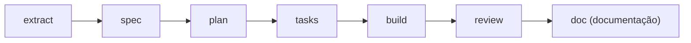

# Toolkit de migração de código

Esta seção explica o que é o toolkit e como ele funciona por dentro. Leia primeiro este arquivo. Ele aponta para os outros documentos.

## O que é

O toolkit é um conjunto de **agentes** (assistentes de IA, cada um com uma tarefa fixa), **skills** (instruções reutilizáveis) e um script de verificação. Tudo fica na pasta `.claude/` do projeto. Com ele, o Claude Code migra código de uma linguagem para outra, uma **unidade** por vez.

Uma unidade é a menor parte do sistema que funciona sozinha, como um endpoint da API (backend), ou uma tela ou funcionalidade de frontend web ou mobile. Cada unidade passa por sete etapas, nesta ordem:



Cada etapa tem um **agente dono**. É o agente que executa a etapa e grava o resultado. O resultado pode ser:

- um artefato em `docs/migration/<unidade>/`;
- o código no destino;
- a documentação da unidade.

O objetivo é o **comportamento igual ao da origem**. As mesmas entradas são aceitas e recusadas, e as saídas e os erros são os mesmos.

Uma decisão do código legado (o sistema original) que contraria boa prática é preservada. Ela é registrada em um ADR (regra 10).

O estado de cada etapa não fica em um arquivo próprio. O script `check.sh` calcula o estado a partir dos artefatos.

(`skills/migrate/SKILL.md`, `skills/migrate/references/stages.md`, `skills/migration-conduct/SKILL.md`, seção 1)

## Para quem

- **Quem migra:** o time que roda `/migrate` no projeto de destino.
- **Quem mantém o toolkit:** quem edita `CLAUDE.md`, a pasta `agents/` ou a pasta `skills/`. Os formatos, os donos e os estados ficam em `skills/migrate/references/`.
- **Quem responde às decisões:** quem responde às perguntas de `/migrate ask`, sobre as escolhas que o código de origem não decide.

## Requisitos

Antes de começar, confira o ambiente:

- **Claude Code** com suporte a subagentes e a skills. O `/migrate` despacha cada etapa para um agente com a ferramenta Agent (`skills/migrate/SKILL.md`).
- **Shell POSIX `sh`**: Linux, macOS ou Git Bash no Windows. Shell POSIX é o terminal padrão de sistemas Unix. Git Bash é esse terminal no Windows. O `check.sh` é um script `sh` (`skills/migrate/scripts/check.sh`, cabeçalho).
- **Utilitários usados pelo `check.sh`:** `awk`, `basename`, `cksum`, `cut`, `grep`, `head`, `sed`, `sort`, `tr`, `uniq` e `wc`.
- **`git`**, para criar o snapshot da origem e ler o commit dele (`skills/migrate/references/intake.md`, seção `Create the snapshot`).
- **Acesso de leitura** ao repositório de origem, pelo caminho local ou pela URL, na `source_ref` escolhida.
- **Permissão de escrita** na pasta `.claude/` do projeto de destino. A memória do projeto, quando houver, fica em `.claude/memory/` (`CLAUDE.md`, seção Project memory).

## Início rápido

Estes são os comandos principais:

```
/migrate init
/migrate status
/migrate <unidade>
/migrate <unidade> <etapa>
/migrate ask [unidade]
```

1. **Copie** a pasta `.claude/` para a raiz do projeto de destino.
2. **Rode `/migrate init`.** O comando pergunta só o que falta em `docs/migration/MIGRATION.md`: origem, destino, tipo de unidade e idiomas.
   - Depois cria o **snapshot**, que é uma cópia da origem no commit indicado, fora do projeto.
   - Confere o **pin**, que é o commit da origem fixado em `source_sha`, com a saída `pin OK`.
   - Lista as unidades candidatas.
   - Grava no **backlog** (a lista de unidades) só as que você confirmar (`skills/migrate/references/intake.md`).
3. **Rode `/migrate status`.** O comando mostra o estado de cada etapa de cada unidade. Ele não altera arquivos (`skills/migrate/scripts/check.sh`, comando `status`).
4. **Rode `/migrate <unidade>`.** As etapas rodam em ordem até a unidade ficar **READY** (extract, spec, plan e tasks em OK) ou até uma parada.
   - O build só roda se você pedir.
   - Para rodar uma etapa só, use `/migrate <unidade> <etapa>`. As etapas anteriores precisam estar OK (`skills/migrate/SKILL.md`).
5. **Quando o fluxo parar com uma pergunta,** rode `/migrate ask`. Só as escolhas do usuário viram pergunta. Fatos, padrões de conduta e o que o código legado responde são resolvidos sem perguntar ao usuário (`skills/migrate/references/ask.md`, seção 2).
6. **Depois de `/clear`,** rode `/migrate` de novo para retomar. O toolkit não guarda estado fora dos artefatos (`skills/migrate/SKILL.md`).

## Documentos

Esta pasta, `.claude/docs/`, guarda a documentação do toolkit. Ela tem sete arquivos:

- [README.md](README.md): este índice, o início rápido, os requisitos e o glossário.
- [arquitetura.md](arquitetura.md): as peças do toolkit, como agentes e skills trabalham juntos, os recursos nativos do Claude Code usados e a execução em segundo plano.
- [agentes.md](agentes.md): os sete agentes, com finalidade, nome técnico, apelido, uso e recursos de cada um.
- [skills.md](skills.md): as skills de fluxo, de conduta e de linguagem, com a finalidade de cada uma e como são acionadas.
- [fluxo.md](fluxo.md): as etapas, os artefatos, os estados, as decisões, a escada de paridade, os limites, as estratégias e as receitas.
- [convencoes.md](convencoes.md): nomes, frontmatter, estilo, idiomas, marcadores, ids, estados e onde cada regra mora.
- [manutencao.md](manutencao.md): como adicionar, atualizar e aposentar agentes e skills, validar o toolkit e resolver problemas.

Cada assunto tem uma regra completa. Use a tabela abaixo para achar o arquivo certo:

| Assunto | Onde ler |
|---|---|
| Idioma das respostas, dos docs e dos artefatos | `CLAUDE.md`, seção Language |
| Comandos e fluxo do orquestrador | `skills/migrate/SKILL.md` |
| Entrada, init, snapshot e backlog | `skills/migrate/references/intake.md` |
| Etapas, critérios de OK e estados | `skills/migrate/references/stages.md` |
| Donos das etapas e limites de despacho | `skills/migrate/references/routing.md` |
| Decisões: fato, padrão de conduta ou escolha do usuário | `skills/migrate/references/ask.md` |
| Formatos dos artefatos, ids e o modelo de ADR | `skills/migrate/references/templates.md` |
| As doze regras obrigatórias, o contrato da mensagem final e as decisões legadas (DEC e ADR) | `skills/migration-conduct/SKILL.md`, seções 0, 12 e 13 |
| Agentes, um por dono de etapa | `agents/*.md` |
| Regras de cada linguagem (golang, java, python, nodejs, typescript, javascript, dotnet, rust e flutter) | `skills/<linguagem>/SKILL.md` |
| Lógica dos estados e das verificações | `skills/migrate/scripts/check.sh` |

### Pendências

- Nenhuma. Os sete documentos desta pasta existem, e nenhum arquivo do toolkit fora desta pasta cita os nomes deles.

## Glossário

Estes são os termos que aparecem no toolkit. A coluna **Fonte** mostra onde a regra completa está.

| Termo | Significado | Fonte |
|---|---|---|
| unidade | A menor parte do código que se comporta sozinha. O id tem de casar com `^[a-z0-9]+(-[a-z0-9]+)*$`. As unidades migram na ordem de dependência do backlog. | `skills/migrate/references/intake.md` |
| snapshot | Cópia da origem no `source_ref`, feita fora do projeto de destino. Por padrão fica em `../<nome-do-destino>-source`. Nunca se escreve nela. | `skills/migrate/references/intake.md` |
| pin | O commit exato da origem usado como referência, guardado em `source_sha`. `check.sh pin` confere se o HEAD do snapshot é esse commit e imprime `pin OK`. | `skills/migrate/scripts/check.sh`, `skills/migrate/references/intake.md` |
| MIGRATION.md | O arquivo `docs/migration/MIGRATION.md`. Tem os metadados do projeto (origem, pin, destino, idiomas e limites) e o backlog. | `skills/migrate/references/templates.md` |
| artefato | Arquivo que uma etapa grava em `docs/migration/<unidade>/`: `extraction.md`, `spec.md`, `plan.md`, `tasks.md` ou `review.md`, além dos ADR em `docs/migration/adr/`. Cada um começa com `status: draft`. | `skills/migrate/references/templates.md` |
| estado | Resultado que o `check.sh` calcula para cada etapa: MISSING, DRAFT, BLOCKED, INVALID, STALE ou OK. | `skills/migrate/references/stages.md`, `skills/migrate/scripts/check.sh` |
| STALE | Estado de um artefato que ficou para trás: o artefato de que ele depende, ou o código, mudou depois que ele foi escrito. Precisa ser gerado de novo. | `skills/migrate/references/stages.md`, `skills/migration-conduct/SKILL.md`, seção 0 (regra 5) |
| READY | Estado da unidade quando extract, spec, plan e tasks estão OK. Build, review e doc vêm depois. | `skills/migrate/references/stages.md` |
| NEEDS | Última linha da mensagem final de um agente. `NEEDS: none` quer dizer que não há pendência. `NEEDS: user: <pergunta>` para a unidade e leva a pergunta ao `/migrate ask`, salvo se `verified:` não cita caminho legado: nesse caso volta ao behavior-extractor. `NEEDS: <dono>: <fato>` pede ao agente dono, se a tabela de roteamento permitir. | `skills/migrate/references/routing.md`, `skills/migration-conduct/SKILL.md`, seção 12 |
| RV | Achado da revisão, `RV-NNN`, em `review.md`. O status é `open`, `fixed`, `dismissed` ou `blocked`. Uma revisão com RV aberto ou bloqueado não pode ser OK. | `skills/migrate/references/templates.md`, `skills/migrate/scripts/check.sh` (função `review_line`) |
| PEND | Decisão pendente da especificação, `PEND-NNN`, com `blocking: yes` ou `no`. Um PEND bloqueante sem `resolution` deixa a especificação em BLOCKED. | `skills/migrate/references/templates.md`, `skills/migrate/scripts/check.sh` (função `open_blocking_pend`) |
| ID | Decisão de planejamento, `ID-NNN`, em `plan.md`. O status é `proposed` ou `accepted`. | `skills/migrate/references/templates.md` |
| BR | Regra de negócio extraída do código de origem, `BR-<SLUG>-NNN`. Sempre traz uma citação `path:line @sha7`. Sem citação, o `check.sh` reprova a regra. Cada citação traz também um trecho entre aspas, que o `check.sh cites` confere dentro da faixa citada. | `skills/migration-conduct/SKILL.md`, seção 0 (regras 1 e 2), seção 2, `skills/migrate/scripts/check.sh` |
| DC | Captura diferida, `DC-NNN`: um comportamento de borda (o framework decide: status e cabeçalhos de rota não encontrada, texto de erro do servidor, formato de log) que a especificação não declara. Não bloqueia as etapas anteriores; a etapa de build grava a saída do legado e a compara. Ver seção 1a. | `skills/migration-conduct/SKILL.md`, seção 1a, `skills/migrate/references/stages.md` |
| FR | Requisito funcional da especificação, `FR-NNN`. Cada FR tem a linha `Source: BR-...`. | `skills/migrate/references/templates.md`, `skills/migration-conduct/SKILL.md`, seção 0 (regra 2) |
| TS | Requisito do destino, `TS-NNN`, com a linha `Source: FR-NNN`. | `skills/migrate/references/templates.md` |
| NG | Não objetivo da especificação, `NG-NNN`: comportamento da origem que a unidade não reproduz. | `skills/migration-conduct/SKILL.md`, seção 6 |
| AG | Antiobjetivo da especificação, `AG-NNN`: comportamento que o alvo nunca pode ter. | `skills/migration-conduct/SKILL.md`, seção 6 |
| prazo | Data-limite do projeto no campo `deadline` de `MIGRATION.md`: `none` (sem prazo) ou `AAAA-MM-DD`. Com prazo, ele define a ordem do trabalho e o que cabe; nunca muda comportamento legado nem dispensa teste. `OVERDUE` no `status` quando a data passa, e não bloqueia a unidade. | `skills/migrate/references/intake.md`, `skills/migrate/references/routing.md` (seção Deadline) |
| T | Tarefa de `tasks.md`, `T-NNN`. Tem os campos `kind` (capture, setup, test, impl ou verify), `depends`, `files`, `spec`, `validation` e `evidence`. | `skills/migrate/references/templates.md` |
| DEC | Decisão legada, `DEC-NNN`: comportamento que o código de origem implementa de propósito e que contraria uma boa prática reconhecida. Fica listado em `extraction.md`, com citação. | `skills/migration-conduct/SKILL.md`, seção 13 |
| ADR | Registro de decisão, `ADR-NNN`, em `docs/migration/adr/ADR-NNN-<slug>.md`: um para cada DEC, com a razão de manter o comportamento legado. Só o usuário muda o status, para `superseded`. | `skills/migration-conduct/SKILL.md`, seção 13; `skills/migrate/references/templates.md` |
| known-issue | Marcador de um bug da origem que o destino mantém de propósito. Corrigir o bug é decisão da especificação. Precisa de referência. | `skills/migration-conduct/SKILL.md`, seção 5 |
| deviation | Marcador de uma diferença do destino em relação a um padrão ou a uma norma, feita de propósito. Precisa de motivo e referência. | `skills/migration-conduct/SKILL.md`, seção 5 |
