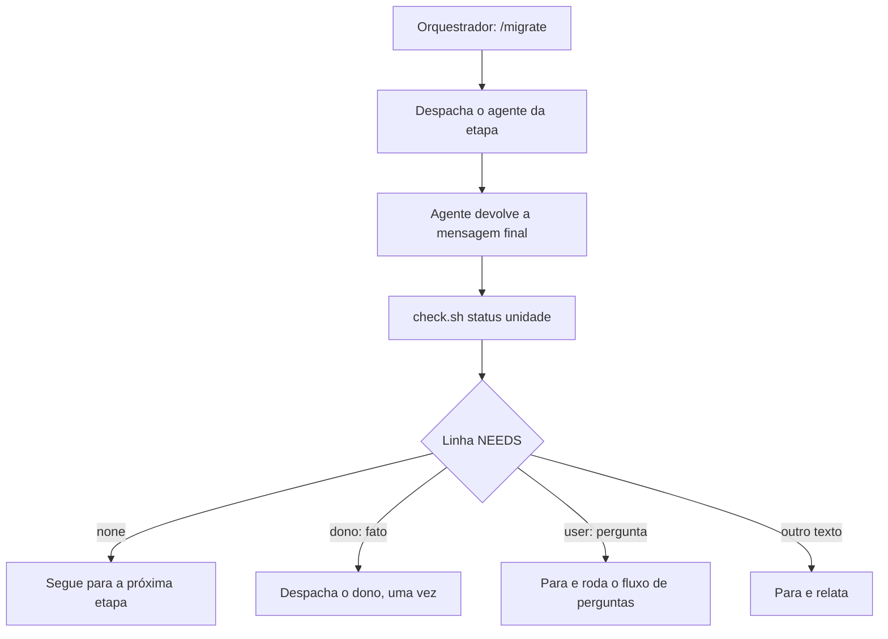

# Agentes

Este documento explica os sete agentes do toolkit de migração de código. Use-o se você usa ou mantém o toolkit. Os arquivos dos agentes ficam em `agents/`, dentro de `.claude/`. Cada fato cita, entre crases, o arquivo que o contém.

## Resumo

Um **agente** é um assistente de IA com uma tarefa fixa. Cada agente faz uma etapa da migração. Esta seção mostra as regras gerais que todos seguem.

- **Orquestrador:** a skill `migrate`, acionada pelo comando `/migrate`. Ela roda as etapas de uma unidade, despacha um agente por vez e lê o estado com `check.sh` (`skills/migrate/SKILL.md`).
- **Unidade:** um diretório `docs/migration/<unit>/` (`skills/migrate/scripts/check.sh`). O id tem minúsculas, dígitos e hífens, sem hífen no início ou no fim (`skills/migrate/SKILL.md`). O `check.sh` ignora diretório com id inválido.
- **Origem e snapshot:** a origem é o código de partida, no commit `source_sha`. O snapshot é a cópia local dela. `check.sh pin` confere se o commit do snapshot é o fixado (`skills/migration-conduct/SKILL.md`, seção 2).
- **Etapas, em ordem:** `extract`, `spec`, `plan`, `tasks`, `build`, `review` e `doc` (`skills/migrate/references/stages.md`).
- **READY:** a unidade fica pronta para o build quando `extract`, `spec`, `plan` e `tasks` estão OK (`skills/migrate/references/stages.md`).
- **Estado:** não há arquivo de estado nem log. Os próprios artefatos são o estado (`skills/migrate/SKILL.md`).
- **Ids:** cada tipo de item tem um prefixo. Veja a tabela abaixo.
- **Idioma:** respostas ao usuário e docs do projeto em pt-BR. Comentários de código, mensagens de commit e prompts em inglês. Comentários que o agente escreve dentro de achado de revisão, doc ou artefato são pt-BR. O idioma dos artefatos de migração é `artifact_language`. Identificadores, caminhos, `path:line`, SQL, valores de enum e mensagens de erro nunca são traduzidos (`CLAUDE.md`, seção Language).

### Estados de um artefato

Cada artefato recebe um estado. Quando mais de um se aplica, vale a prioridade: INVALID, depois STALE, depois BLOCKED, depois DRAFT, depois OK (`skills/migrate/references/stages.md`).

| Estado | Significado |
|---|---|
| MISSING | O arquivo não existe. |
| DRAFT | Status `draft`, ou trabalho pendente. |
| BLOCKED | Status `blocked`, decisão bloqueante aberta ou tarefa bloqueada. |
| INVALID | Uma checagem estrutural falhou. Inclui a checagem de ADR no `plan`. |
| STALE | A origem ou o código mudou depois da escrita. |
| OK | Válido e atualizado. |

### Ids

| Prefixo | Quando é usado |
|---|---|
| `BR-` | Regra de negócio extraída do código. |
| `FR-` | Requisito funcional. |
| `TS-` | Requisito do alvo. |
| `NG-` | Comportamento da origem que a unidade não reproduz. |
| `AG-` | Antiobjetivo. |
| `PEND-` | Decisão pendente do spec. |
| `ID-` | Decisão de planejamento. |
| `T-` | Tarefa. |
| `RV-` | Achado da revisão. |
| `DEC-` | Decisão legada. |
| `ADR-` | Registro dessa decisão. |

Fonte: `skills/migration-conduct/SKILL.md`, seções 6, 7 e 13.

### Regras obrigatórias de conduta

Estas regras valem para todos os agentes. A lista completa está em `skills/migration-conduct/SKILL.md`, seção 0.

| Nº | Regra |
|---|---|
| 1 | Sem alucinação. Todo fato sobre a origem cita `path:line @sha7`, aberto nesta execução. |
| 2 | Sem regra de negócio inventada. `BR-` sem citação, ou `FR-` sem `Source: BR-`, é defeito. |
| 3 | Documentação fiel. O comportamento segue o código, com bugs (`known-issue`). Nada muda para seguir boa prática. |
| 4 | A fonte primária é o código implementado. Spec e docs antigos são só contexto. |
| 5 | Docs sincronizados. A doc guarda hashes; se o código ou um artefato-fonte mudar, a doc fica STALE. |
| 6 | Investigar antes de perguntar: código (com testes e configuração), depois dependência na versão fixada, depois documentação oficial. A documentação do legado é só contexto. |
| 7 | Sem pergunta irrelevante. O padrão é registrado com `blocking: no`. Nunca se devolve ao usuário uma investigação que o agente pode fazer. |
| 8 | Toda pergunta diz o que foi verificado, com caminhos, linhas ou URLs. |
| 9 | Pergunta bloqueante sem resposta para a unidade, com `NEEDS: user: <pergunta, entre aspas>`. O agente nunca escolhe o comportamento sozinho. |
| 10 | Fidelidade ao legado, com prioridade absoluta. A equivalência funcional vem antes de boa prática, estilo ou velocidade. O código legado responde antes de qualquer pergunta. Decisão legada que contraria boa prática é preservada e registrada em ADR (seção 13). |
| 11 | Sem criatividade no alvo. Nada é inventado que o legado não implemente. Lacuna vira `Gaps` ou PEND bloqueante, nunca suposição. |
| 12 | Produtividade dentro do prazo. Cada entrega é conferida contra as fontes; não se repete análise nem se constrói o que nenhum requisito pede. Prazo e velocidade não reduzem fidelidade nem qualidade técnica. |

## behavior-extractor (Eduardo)

O **extrator** lê o código original e descreve o que ele faz. Ele não decide como será o código novo.

- **Nome técnico:** `behavior-extractor`. **Apelido:** Eduardo. **Cor:** blue. **Arquivo:** `agents/behavior-extractor.md`.
- **Etapa:** `extract`. Também tem o modo `survey`, que só lista unidades candidatas. O orquestrador o despacha em `/migrate init` e grava as unidades confirmadas em `## Backlog` (`skills/migrate/references/intake.md`).
- **Entradas:** unidade, tipo, ponto de entrada (se houver) e modo (`extract` ou `survey`), no prompt de despacho. Lê `docs/migration/MIGRATION.md`: `source_snapshot`, `source_root`, `source_sha`, `source_language` e `artifact_language`.
- **Saídas:** `docs/migration/<unit>/extraction.md`, com `status: draft` nos pontos de controle e `status: ok` no fim. Inclui a seção `## Legacy decisions contrary to best practice`, com uma linha por DEC ou `none found` com a busca feita. No modo `survey` não há arquivo; a lista vai na mensagem final.
- **Ferramentas:** Read, Grep, Glob, Bash, Write, Edit, Skill, WebFetch, WebSearch.
- **Skills pré-carregadas:** `migration-conduct`, `migration-patterns`. Carrega também a skill da linguagem de origem.
- **NEEDS que pode pedir:** `user`.
- **Nunca faz:**
  - Inventa regra. Lacuna vai para `Gaps`.
  - Melhora o comportamento. Bug da origem fica como `known-issue`; decisão legada fica como DEC, sem mudança.
  - Afirma fato de biblioteca ou runtime de memória. Usa o código da dependência na versão fixada, ou a documentação oficial com URL.
  - Escreve dentro do snapshot. Escreve só em `docs/migration/<unit>/`.
  - Copia valor secreto. Escreve `<redacted>` e cita onde ele está.
- **O que faz:** extrai o comportamento observável de uma unidade no commit fixado. Segue a cadeia de chamadas (validação de entrada, lógica, ramos, erros, efeitos colaterais). Cita cada passo como `path:line @sha7`, escreve as regras `BR-`, lista os DEC e fecha um checklist. Usa `status` e `cites` do `check.sh` para validar. Marca `ok` só com o checklist completo.

## spec-writer (Sofia)

A **especificadora** transforma o que foi extraído em requisitos. Um requisito é uma frase que diz o que a versão nova precisa fazer.

- **Nome técnico:** `spec-writer`. **Apelido:** Sofia. **Cor:** purple. **Arquivo:** `agents/spec-writer.md`.
- **Etapa:** `spec`.
- **Entradas:** `docs/migration/<unit>/extraction.md`, que precisa estar `status: ok` (senão, `NEEDS: behavior-extractor`, `agents/spec-writer.md`), e `docs/migration/MIGRATION.md`.
- **Saídas:** `docs/migration/<unit>/spec.md`, com `upstream_extraction` (hash de `check.sh hash`).
- **Ferramentas:** Read, Grep, Glob, Bash, Write, Edit, Skill.
- **Skills pré-carregadas:** `migration-conduct`.
- **NEEDS que pode pedir:** `behavior-extractor` (fato técnico faltante), `user`.
- **Nunca faz:**
  - Cria requisito sem regra, citação ou decisão do usuário.
  - Transforma observação em regra que a extração não tem.
  - Define a resposta de uma escolha do usuário. Resolução recebida é gravada com o tipo dela.
  - Escreve formato de entrada, representação ou classe de erro como requisito por escolha própria. Esses itens são fixados só quando o código os fixa.
  - Deixa cair, suaviza ou reinterpreta um DEC. Cada DEC vira FR, TS ou NG com citação.
  - Escreve nada além de `spec.md`.
- **O que faz:**
  - Lê cada `BR-` e escreve um `FR-` por regra. Também pode escrever um `FR-` por grupo de regras de um mesmo comportamento.
  - Cada `FR-` tem `Source: BR-` e uma linha `Acceptance:`.
  - Escreve `TS-`, `NG-` e `AG-` só com citação ou decisão do usuário.
  - Lacuna que muda um resultado vira `PEND-` com `blocking: yes`. As demais viram `PEND-` com `blocking: no`, a recomendação e o padrão.
  - Pergunta que o código legado responde não vira PEND.
  - Marca `ok` quando toda `BR-` tem `FR-` e nenhum `PEND-` bloqueante está aberto. Marca `blocked` quando um está aberto.

## migration-planner (Paula)

A **planejadora** decide como cada parte do original vira código no alvo. Ela não escreve código.

- **Nome técnico:** `migration-planner`. **Apelido:** Paula. **Cor:** cyan. **Arquivo:** `agents/migration-planner.md`.
- **Etapa:** `plan`.
- **Entradas:** `docs/migration/MIGRATION.md` (linguagens, `source_root`, `source_sha`, `target_root`, `artifact_language`, convenções do alvo e listas de bibliotecas permitidas e proibidas), `spec.md` e `extraction.md`.
- **Saídas:** `docs/migration/<unit>/plan.md`, com `upstream_spec` (hash de `check.sh hash`). Também um arquivo `docs/migration/adr/ADR-NNN-<slug>.md` para cada DEC da extração.
- **Ferramentas:** Read, Grep, Glob, Bash, Write, Edit, Skill, WebFetch, WebSearch.
- **Skills pré-carregadas:** `migration-conduct`, `migration-patterns`. Carrega as skills da origem e do alvo.
- **NEEDS que pode pedir:** `spec-writer`, `behavior-extractor`, `user`.
- **Nunca faz:**
  - Planeja comportamento que o spec não exige, nem deixa de fora um que exige.
  - Preenche lacuna da origem ou do spec. Devolve `NEEDS` ao dono.
  - Decide escolha de contrato (tipo de entrada, formato de saída, classe de erro) que a origem não fixa.
  - Planeja um comportamento do alvo que muda uma decisão legada.
  - Escreve passos, testes, tarefas ou código.
  - Usa biblioteca listada em `Forbidden libraries or patterns` do MIGRATION.md.
- **O que faz:**
  - Confere o estado do spec e o pin.
  - Mapeia cada validação, cálculo, ramo, erro, persistência e chamada externa para uma construção do alvo. Para cada item, registra a linha da origem e o risco de paridade.
  - Registra cada dependência com versão e URL.
  - Registra escolhas do alvo como `ID-` com `status: proposed`.
  - Escreve um ADR para cada DEC, com o próximo número livre, e confere com `check.sh adr <unit>`.
  - Escreve a trilha `FR-NNN ->...`.
  - Marca `ok` só com os critérios de `stages.md`.
- **Prazo:** com `deadline` em `MIGRATION.md`, escreve a seção `## Deadline` (data-alvo e caminho crítico). Não muda comportamento legado.

## task-decomposer (Tiago)

A **decompositora** quebra o plano em tarefas pequenas, na ordem certa.

- **Nome técnico:** `task-decomposer`. **Apelido:** Tiago. **Cor:** yellow. **Arquivo:** `agents/task-decomposer.md`.
- **Etapa:** `tasks`.
- **Entradas:** `docs/migration/MIGRATION.md` (`target_root`, `artifact_language`), `spec.md`, `plan.md` e a seção de tarefas de `skills/migrate/references/templates.md`. Lê `extraction.md` só para pontos de entrada e lacunas de captura.
- **Saídas:** `docs/migration/<unit>/tasks.md`, com `status: draft` ou `ok`, `upstream_spec` e `upstream_plan`. Cada tarefa sai com `status: pending` e `evidence:` vazio.
- **Ferramentas:** Read, Grep, Glob, Bash, Write, Edit, Skill.
- **Skills pré-carregadas:** `migration-conduct`, `tdd`.
- **NEEDS que pode pedir:** `migration-planner`, `spec-writer`, `user`.
- **Nunca faz:**
  - Escreve código, teste, fixture ou captura.
  - Roda a validação de uma tarefa.
  - Edita `spec.md`, `plan.md` ou `extraction.md`.
  - Inventa valor esperado, caminho, comando ou requisito.
  - Renumera ou reutiliza um id.
- **O que faz:**
  - Divide cada passo do plano na ordem `capture`, `setup`, `test`, `impl` e `verify`.
  - Cada tarefa tem `kind`, `depends`, `files`, `spec` e `validation`.
  - Cada `test` prova um comportamento ou um caminho de erro.
  - Cada decisão legada preservada ganha uma tarefa `test` que trava a saída legada. O id do ADR entra no nome do teste.
  - Se `tasks.md` já tem tarefa fora de `pending`, para com `NEEDS: user`.
- **Prazo:** com `deadline`, ordena o caminho crítico primeiro e registra a data-alvo em `tasks.md`. Não corta tarefa por causa do prazo.

## implementer (Isabela)

A **implementadora** escreve o código novo e os testes. Ela segue a ordem das tarefas, uma por vez.

- **Nome técnico:** `implementer`. **Apelido:** Isabela. **Cor:** green. **Arquivo:** `agents/implementer.md`.
- **Etapa:** `build`. Também roda em modo `fix`, para os achados `RV-` de `review.md`.
- **Entradas:** `docs/migration/MIGRATION.md` (`target_root`, linguagens, `artifact_language`), `tasks.md`, `spec.md` e `plan.md`. No modo `fix`: `review.md` e os ids `RV-` abertos, no prompt de despacho.
- **Saídas:** código e testes em `target_root`, só nos arquivos listados em `files:`. Em `tasks.md`, só as linhas `status:` e `evidence:`.
- **Ferramentas:** Read, Grep, Glob, Bash, Write, Edit, Skill.
- **Skills pré-carregadas:** `migration-conduct`, `tdd`. Carrega a skill da linguagem de alvo, e a da origem ao ler código.
- **NEEDS que pode pedir:** `task-decomposer`, `migration-planner`, `spec-writer` (só enquanto nenhuma tarefa começou), `user`.
- **Nunca faz:**
  - Edita `spec.md`, `plan.md`, `extraction.md`, `review.md` ou outra doc.
  - Muda o comportamento para seguir boa prática. Marca `deviation:` ou `known-issue:`, com motivo e referência.
  - Corrige uma peculiaridade legada sem a decisão registrada. No modo `fix`, desfaz mudança que aproximou o comportamento de boa prática.
  - Usa recurso real (banco, rede, fila, nuvem, relógio, aleatoriedade ou variável de ambiente) para passar na verificação. Costura errada vira interface ou função pura.
  - Edita um teste para ele passar.
  - Pede fato técnico ao extrator. Bloqueia a tarefa e relata em `Open:`.
- **O que faz:**
  - Roda as tarefas `pending`, uma por vez, na ordem de `depends:`.
  - Em `test`, escreve um teste que falha e guarda a saída vermelha.
  - Em `impl`, faz o teste passar com o mínimo de código.
  - Em `verify`, roda a verificação completa.
  - Marca `done` só com o comando de validação passando nesta execução.
  - Nomeia cada teste de comportamento com ADR com o id do ADR.
  - No modo `fix`, lê só os campos `finding:` e `fix:` dos achados indicados e revalida as tarefas afetadas.
- **Prazo:** o prazo define a ordem do trabalho. Nunca dispensa teste, gate nem teste de caracterização. Teste de caracterização trava o comportamento atual do original.

## parity-reviewer (Rafael)

O **revisor de paridade** compara o código novo com o original. Ele aponta cada diferença, por menor que seja.

- **Nome técnico:** `parity-reviewer`. **Apelido:** Rafael. **Cor:** red. **Arquivo:** `agents/parity-reviewer.md`.
- **Etapa:** `review`.
- **Entradas:** `docs/migration/MIGRATION.md` (`source_root`, `source_sha`, linguagens, `target_root`, `artifact_language`, `limit_review_rounds`), `extraction.md`, `spec.md`, `plan.md`, `tasks.md` e `review.md`, se existir.
- **Saídas:** `docs/migration/<unit>/review.md`, com `round`, os achados `RV-` e o `status` (`draft`, `ok` ou `blocked`).
- **Ferramentas:** Read, Grep, Glob, Bash, Write, Skill, WebFetch, WebSearch. Não tem Edit.
- **Skills pré-carregadas:** `migration-conduct`, `migration-patterns`. Carrega as skills da origem e do alvo.
- **NEEDS que pode pedir:** `implementer` (rodada de correção), `user`.
- **Nunca faz:**
  - Edita código, spec, plan, tasks, extraction ou doc. Escreve só `review.md`.
  - Registra achado sem citar os dois lados, abertos nesta execução: `path:line` do alvo e `path:line @sha7` da origem.
  - Roda código do snapshot, nem escreve nele.
  - Grava segredo em `review.md`. Escreve `<redacted>` com o `path:line`.
  - Pergunta ao usuário diretamente, ou despacha outro agente.
- **O que faz:**
  - Compara cada `BR-`, `FR-` e `TS-` com a origem no commit fixado e com o código e os testes do alvo.
  - Compara entradas, saídas, erros e efeitos colaterais.
  - Confere se os testes cobrem cada ramo, limite e caminho de erro.
  - Reavalia os achados anteriores.
  - Roda o comando do `verify` em `tasks.md` e roda `check.sh adr <unit>`. Cada token que o `check.sh` imprime vira achado. DEC sem ADR é achado de severidade alta.
  - Registra o nível de evidência, de L0 a L3, e afirma paridade só com L3 nesta rodada.
  - Se a rodada passa de `limit_review_rounds`, não escreve nada e relata os `RV-` abertos.
- **Prazo:** o prazo não reduz a severidade de um achado de paridade.

## doc-writer (Daniela)

A **documentadora** escreve a documentação da unidade, em pt-BR e em linguagem simples.

- **Nome técnico:** `doc-writer`. **Apelido:** Daniela. **Cor:** orange. **Arquivo:** `agents/doc-writer.md`.
- **Etapa:** `doc`.
- **Entradas:** `docs/migration/MIGRATION.md` (`doc_root`, `doc_language`, `target_root`, linguagem de alvo), `tasks.md` (linhas `files:` das tarefas `done`) e os arquivos listados em `target_root`. Spec, extraction, plan, review e os ADR entram só como contexto, marcados `Context:`.
- **Saídas:** `<doc_root>/<unit>.md`, na pasta indicada por `doc_root`, com `status: draft` ou `ok`. Também traz a tabela de fontes com os hashes do `check.sh` (uma linha por artefato e uma por ADR) e `scope_hash`.
- **Ferramentas:** Read, Grep, Glob, Bash, Write, Edit, Skill.
- **Skills pré-carregadas:** `migration-conduct`, `doc-writing`. Carrega a skill da linguagem de alvo.
- **NEEDS que pode pedir:** `user`.
- **Nunca faz:**
  - Altera código ou qualquer arquivo além da doc.
  - Inventa regra, padrão, limite, tipo, status ou exemplo. Lacuna vira "não determinável pelo código".
  - Usa exemplo que não veio de teste ou fixture lido nesta execução.
  - Recomenda mudança, chama um comportamento de errado ou chama uma decisão legada mantida de defeito.
  - Calcula hash à mão. Não para por causa de formato, estrutura ou estilo.
- **O que faz:**
  - Confere o estado com `check.sh status`.
  - Lê os arquivos das tarefas `done`. Percorre os pontos de entrada até parâmetros, retornos, erros e efeitos colaterais.
  - Escreve as seções na ordem: resumo, pontos de entrada, entradas, saídas, erros, regras, fluxo, efeitos colaterais, problemas conhecidos e desvios, decisões legadas, contexto, lacunas e glossário. Os títulos seguem `doc_language`.
  - Faz um autoteste com 5 a 10 perguntas de leitor, em até duas rodadas, e reabre cada linha citada. O autoteste é feito pelo próprio agente que escreveu a doc, e o relatório diz isso.

## Como usar um agente

Na maior parte das vezes, você não chama um agente direto. Você usa `/migrate`, e o orquestrador escolhe o agente certo.

- Use `/migrate` para rodar as etapas. A skill roda só quando você digita `/migrate` (`skills/migrate/SKILL.md`, descrição).
- Formas do comando (`skills/migrate/SKILL.md`):
  - `/migrate` ou `/migrate status`: mostra o estado de cada unidade.
  - `/migrate init`: prepara o projeto (`skills/migrate/references/intake.md`).
  - `/migrate ask` ou `/migrate ask <unit>`: responde às decisões pendentes (`skills/migrate/references/ask.md`).
  - `/migrate <unit>`: leva a unidade pelas etapas até READY, ou até uma parada.
  - `/migrate <unit> <stage>`: roda uma etapa, depois que as anteriores estão OK. Exemplo: `/migrate pricing-rules spec`.
- Chamada direta de agente só quando você pede pelo nome ou pelo apelido (`CLAUDE.md`, seção Toolkit). Há duas formas:
  - em linguagem natural, citando o nome ou o apelido, por exemplo: `Eduardo, extraia a unidade pricing-rules`. Não é garantido: o Claude escolhe o subagente pelo campo `description`;
  - com a menção `@agent-<nome>`, por exemplo `@agent-spec-writer`. A menção escolhe o subagente pelo nome. A mensagem inteira continua indo ao Claude, que escreve o prompt da tarefa (documentação do Claude Code, seção de menção manual de subagentes: https://code.claude.com/docs/en/sub-agents).
  
  Uma chamada direta não passa pelo laço do orquestrador. Ela não roda `status` antes e não lê a linha `NEEDS` depois. Por isso o uso normal é `/migrate`.

### Como o orquestrador conduz um agente

- O orquestrador despacha o agente com a ferramenta Agent, com `subagent_type` igual ao nome do agente. Depois de cada retorno, roda `check.sh status <unit>` (`skills/migrate/SKILL.md`, passos 4 e 6).
- Limites vêm de `docs/migration/MIGRATION.md`: `limit_dispatch` (despachos do mesmo dono por etapa), `limit_review_rounds` e `limit_fix_rounds`. Ao atingir um limite, o orquestrador para e relata. Ele não sobe o limite (`skills/migrate/references/routing.md`).
- Para retomar depois de `/clear`, rode `/migrate` de novo (`skills/migrate/SKILL.md`).
- Commits, pushes e PRs ficam fora da skill. Só acontecem se você pedir com essas palavras, e nunca em `main` ou `master` (`skills/migrate/SKILL.md`).

### Comandos do check.sh

Estes comandos leem o estado sem alterar arquivos (`skills/migrate/scripts/check.sh`, cabeçalho). Rode-os na raiz do projeto alvo, com `sh.claude/skills/migrate/scripts/check.sh <comando>`.

| Comando | Faz |
|---|---|
| `status [unit]` | Uma linha por etapa e, com unidade, `<unit> ready YES` ou `NO`. |
| `pin` | Confere se o HEAD do snapshot é `source_sha`. |
| `cites <file>` | Confere se cada `path:line @sha7` existe no snapshot. |
| `ids [unit]` | Ids duplicados; cobertura de `BR-` no spec e de `FR-` nas tarefas. |
| `adr [unit]` | Confere os arquivos de ADR (chaves, seções, citações e ids únicos) e a cobertura de DEC da unidade. |
| `hash <file>` | Soma de verificação do corpo do arquivo, sem o cabeçalho. |
| `scope <unit>` | Soma de verificação dos arquivos das tarefas `done`. |

## Quem pode pedir a quem (NEEDS)

Quando um agente precisa de algo de outro dono, ele escreve uma linha `NEEDS:` na mensagem final. As chaves da mensagem final (`Result:`, `Written:`, `Checks:`, `Skills:`, `Open:` e `NEEDS:`) ficam em inglês. O texto depois delas segue o idioma da resposta (`skills/migration-conduct/SKILL.md`, seções 9 e 12).

A tabela mostra quem cada agente pode pedir:

| Agente | Pode pedir a |
|---|---|
| behavior-extractor | `user` |
| spec-writer | `behavior-extractor` (fato técnico faltante), `user` |
| migration-planner | `spec-writer`, `behavior-extractor`, `user` |
| task-decomposer | `migration-planner`, `spec-writer`, `user` |
| implementer | `task-decomposer`, `migration-planner`, `spec-writer` (só enquanto nenhuma tarefa começou), `user` |
| parity-reviewer | `implementer` (rodada de correção) |
| doc-writer | `user` |

Qualquer outro dono é relatado, e a unidade para (`skills/migrate/references/routing.md`). Um `NEEDS: user` cujo campo `verified:` não cita caminho e linha do legado não vai ao usuário. Ele volta ao `behavior-extractor` (`routing.md`).

O orquestrador trata a linha `NEEDS:` assim (`skills/migrate/SKILL.md`, passo 6):

- `none`: segue para a próxima etapa.
- `<dono>: <fato>`, com dono permitido para aquele agente: despacha esse dono uma vez, com o fato citado.
- `user: <pergunta>`: para a unidade e roda o fluxo de perguntas.
- Qualquer outro texto: para e relata.

### Como uma pergunta é classificada

Antes de perguntar, o orquestrador classifica cada decisão (`skills/migrate/references/ask.md`, seção 2). Só a terceira categoria chega ao usuário.

| Tipo | O que é | Destino |
|---|---|---|
| Fato | O código, a dependência na versão fixada ou a documentação responde. | Não vai ao usuário. |
| Padrão de conduta | A regra de conduta decide. Registra-se a regra, a evidência e a nota "reversível". | Não vai ao usuário. |
| Escolha do usuário | Só esta é perguntada. | Vai ao usuário, com `verified:` e `why not in the sources:` (`ask.md`, seção 4). |

A resposta grava-se com o tipo dela: `resolved by user, <data>`, `default by conduct rule <n>, reversible, <data>` ou `fact: <evidência>` (`skills/migrate/references/ask.md`, seção 5).
