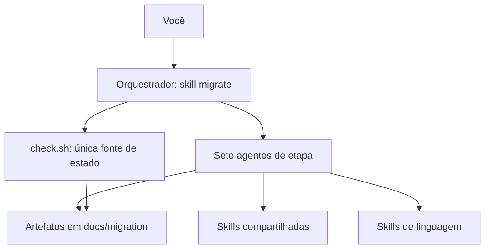
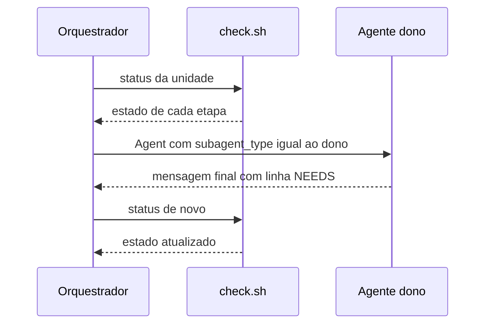

# Arquitetura

Este documento mostra as peças do toolkit, como os dados passam entre elas e quais recursos nativos do Claude Code o toolkit usa. Os caminhos são relativos a `.claude/`. Identificadores, nomes de arquivo, comandos, ids e estados estão escritos exatamente como no código.

## Peças

Esta seção lista quem faz o quê. O toolkit tem quatro tipos de peça: o orquestrador, os sete agentes de etapa, as skills compartilhadas e as skills de linguagem. O script `check.sh` é a única fonte de estado.

### Orquestrador

O orquestrador é a skill `migrate` (`skills/migrate/SKILL.md`). Ela é o cérebro que você aciona com o comando `/migrate`. Só você a aciona, porque o modelo não a chama sozinho (`skills/migrate/SKILL.md`).

O orquestrador:

- roda as etapas em ordem e despacha um agente por vez;
- lê todo estado pelo `check.sh` (`skills/migrate/SKILL.md`);
- não escreve código, especificação, plano, revisão nem documentação (`skills/migrate/SKILL.md`).

Os subcomandos são `init`, `status`, `ask [unidade]` e `<unidade> [etapa]`. As etapas são `extract`, `spec`, `plan`, `tasks`, `build`, `review` e `doc` (`skills/migrate/SKILL.md`).

Arquivos de apoio da skill:

- `skills/migrate/references/intake.md`: o `init`.
- `skills/migrate/references/ask.md`: as decisões pendentes.
- `skills/migrate/references/stages.md`: as etapas, os critérios e os estados.
- `skills/migrate/references/routing.md`: os donos de cada estado e os limites.
- `skills/migrate/references/templates.md`: os modelos dos artefatos, inclusive o de ADR.
- `skills/migrate/scripts/check.sh`: o cálculo dos estados e a validação dos ADR.

### Agentes de etapa

Cada agente escreve a saída de uma etapa. Os apelidos vêm de `CLAUDE.md`, seção "Toolkit". As ferramentas e as skills de cada agente ficam no frontmatter de `agents/<nome>.md`, nos campos `tools:` e `skills:`. O frontmatter é o bloco de configuração no topo do arquivo, entre duas linhas `---`. A correspondência entre etapa e dono está em `skills/migrate/references/stages.md`.

| Agente | Apelido | Etapa | Escreve | Skills carregadas | Ferramentas |
|---|---|---|---|---|---|
| `behavior-extractor` | Eduardo | `extract` | `docs/migration/<unidade>/extraction.md`, com a lista de DEC | `migration-conduct`, `migration-patterns` | Read, Grep, Glob, Bash, Write, Edit, Skill, WebFetch, WebSearch |
| `spec-writer` | Sofia | `spec` | `docs/migration/<unidade>/spec.md` | `migration-conduct` | Read, Grep, Glob, Bash, Write, Edit, Skill |
| `migration-planner` | Paula | `plan` | `docs/migration/<unidade>/plan.md` e um ADR por DEC em `docs/migration/adr/` | `migration-conduct`, `migration-patterns` | Read, Grep, Glob, Bash, Write, Edit, Skill, WebFetch, WebSearch |
| `task-decomposer` | Tiago | `tasks` | `docs/migration/<unidade>/tasks.md` | `migration-conduct`, `tdd` | Read, Grep, Glob, Bash, Write, Edit, Skill |
| `implementer` | Isabela | `build` e correções de `review` | código e testes no `target_root`; status e evidência em `tasks.md` | `migration-conduct`, `tdd` | Read, Grep, Glob, Bash, Write, Edit, Skill |
| `parity-reviewer` | Rafael | `review` | `docs/migration/<unidade>/review.md` | `migration-conduct`, `migration-patterns` | Read, Grep, Glob, Bash, Write, Skill, WebFetch, WebSearch |
| `doc-writer` | Daniela | `doc` | `<doc_root>/<unidade>.md` | `migration-conduct`, `doc-writing` | Read, Grep, Glob, Bash, Write, Edit, Skill |

O campo `skills:` carrega as skills do agente ao iniciar. Um exemplo está em `agents/spec-writer.md`. Todos os agentes usam `effort: medium`, que é o nível de esforço do modelo (`agents/spec-writer.md` e as linhas equivalentes dos outros seis).

### Skills compartilhadas

Quatro skills têm `user-invocable: false`. Isso quer dizer que você não as chama. Só os agentes as carregam.

- `migration-conduct` (`skills/migration-conduct/SKILL.md`): regras comuns a todos os agentes. Tem as doze regras obrigatórias (seção 0), a conduta de paridade e as evidências (seções 1 a 3), as lacunas e conflitos (seção 4), os marcadores (seção 5), o escopo e os segredos (seção 6), os ids (seção 7), a verificação (seção 8), o idioma (seção 9), as skills de linguagem (seção 10), as regras de parada (seção 11), o contrato da mensagem final (seção 12) e as decisões legadas e os ADR (seção 13). Os sete agentes a carregam.
- `migration-patterns` (`skills/migration-patterns/SKILL.md`): categorias de armadilhas que a migração deve checar entre a linguagem de origem e a de destino. São elas: números, texto e codificação, tempo e fusos, valores ausentes, igualdade e ordem, erros, concorrência, serialização, entrada e saída e recursos, configuração, aleatoriedade e relógios, e localidade. Carregada por `behavior-extractor`, `migration-planner` e `parity-reviewer`.
- `tdd` (`skills/tdd/SKILL.md`): método de escrever o teste antes do código (TDD, de *test-driven development*). Inclui nomes de teste com o id da especificação, testes de caracterização contra a origem, isolamento de dependências externas nos testes unitários e a checagem de cobertura. Carregada por `task-decomposer` e `implementer`.
- `doc-writing` (`skills/doc-writing/SKILL.md`): fluxo de escrita da documentação em três estágios, sem perguntas ao usuário: coleta de contexto, redação seção por seção e autoteste de leitura. Carregada por `doc-writer`.

### Skills de linguagem

São nove: `golang`, `java`, `python`, `nodejs`, `typescript`, `javascript`, `dotnet`, `rust` e `flutter` (`CLAUDE.md`, seção "Toolkit"). Cada uma descreve uma linguagem: regras, testes e checagem de qualidade (`skills/<nome>/SKILL.md`).

Nenhum agente as carrega ao iniciar. Um agente carrega a skill da linguagem de origem ou de destino pelo nome, com a ferramenta `Skill`, quando precisa dela (`skills/migration-conduct/SKILL.md`, seção 10).

### Estado do projeto

`docs/migration/MIGRATION.md` guarda os parâmetros do projeto. O `init` os preenche (`skills/migrate/references/intake.md`). O arquivo traz:

- o commit fixado da origem (`source_sha`) e o caminho da cópia da origem (`source_snapshot`);
- as raízes de origem e de destino (`source_root`, `target_root`) e a raiz da documentação (`doc_root`);
- os idiomas de documentação e de artefatos (`doc_language`, `artifact_language`), conforme `CLAUDE.md` e `CLAUDE.md`;
- os limites (`limit_dispatch`, `limit_review_rounds`, `limit_fix_rounds`).

O modelo está em `skills/migrate/references/templates.md`.

## Fluxo de dados

Esta seção mostra por onde o dado passa. Os artefatos em `docs/migration/<unidade>/` e os ADR em `docs/migration/adr/` são o único estado. Não existe arquivo de estado nem log (`skills/migrate/SKILL.md`). Para retomar depois de `/clear`, rode `/migrate` de novo (`skills/migrate/SKILL.md`).

### Artefatos

A ordem das etapas é `extract`, `spec`, `plan`, `tasks`, `build`, `review` e `doc`. A unidade fica `READY` quando `extract`, `spec`, `plan` e `tasks` estão OK. `build`, `review` e `doc` vêm depois (`skills/migrate/references/stages.md`).

| Arquivo | Etapa | Dono | Campos de vínculo |
|---|---|---|---|
| `docs/migration/<unidade>/extraction.md` | `extract` | `behavior-extractor` | `unit`, `stage`, `status`; seção de DEC |
| `docs/migration/<unidade>/spec.md` | `spec` | `spec-writer` | `upstream_extraction` |
| `docs/migration/<unidade>/plan.md` | `plan` | `migration-planner` | `upstream_spec`; seção de ADR |
| `docs/migration/adr/ADR-NNN-<slug>.md` | `plan` | `migration-planner` | `id`, `status`, `unit`, `candidate`, `source_sha` |
| `docs/migration/<unidade>/tasks.md` | `tasks` | `task-decomposer` | `upstream_spec`, `upstream_plan` |
| código e testes no `target_root` | `build` | `implementer` | `files:` de cada tarefa |
| `docs/migration/<unidade>/review.md` | `review` | `parity-reviewer` | `round`, `scope_hash` |
| `<doc_root>/<unidade>.md` | `doc` | `doc-writer` | `scope_hash` e a tabela Sources, com uma linha por ADR |

Os modelos estão em `skills/migrate/references/templates.md`. As etapas e os critérios estão em `skills/migrate/references/stages.md`.

O dono escreve `status` com um dos valores `draft`, `ok` ou `blocked`. O `check.sh` lê o frontmatter como linhas `chave: valor` entre os dois primeiros `---` (`skills/migrate/scripts/check.sh`). Ele também confere se `unit` e `stage` batem com a pasta e com a etapa (`skills/migrate/scripts/check.sh`).

Os campos `upstream_*` guardam o hash do corpo do artefato de origem. Um hash é uma impressão digital do texto: se o texto muda, o hash muda. O hash é o cksum do texto sem o frontmatter, em LF (quebra de linha no formato Unix), calculado por `check.sh hash` (`skills/migrate/references/templates.md`; `skills/migrate/scripts/check.sh`). Se o hash mudou, o artefato fica STALE (`skills/migrate/scripts/check.sh`).

### Estados

Cada etapa recebe um estado. Ele diz se o artefato existe, se está pronto e se precisa de ação.

| Estado | Significado |
|---|---|
| MISSING | o arquivo não existe |
| DRAFT | `status: draft`, ou trabalho pendente |
| BLOCKED | `status: blocked`, decisão bloqueante aberta, ou tarefa `blocked` |
| INVALID | falha em checagem estrutural: ids, cobertura, citações, chaves ou ADR |
| STALE | um artefato de origem ou o código mudou depois que o artefato foi escrito |
| OK | `status: ok` e todas as checagens passaram |

Quando mais de um estado vale, a prioridade é INVALID, STALE, BLOCKED, DRAFT e OK (`skills/migrate/references/stages.md`).

Cada etapa tem regras próprias no `check.sh`:

- `extract`: é INVALID quando falta a seção `## Legacy decisions contrary to best practice` ou quando um `DEC-` não tem citação (`skills/migrate/scripts/check.sh`).
- `plan`: é INVALID quando `check.sh adr <unidade>` acusa problema, como ADR sem DEC, DEC sem ADR ou id de ADR repetido (`skills/migrate/scripts/check.sh`).
- `build`: vem do status das tarefas em `tasks.md`.
  - É DRAFT sem tarefas, ou com tarefa `pending` ou `in_progress`.
  - É BLOCKED com tarefa `blocked`.
  - É INVALID quando uma tarefa `done` não tem `evidence:`, ou quando um arquivo listado não existe.
  - É OK quando todas as tarefas estão `done` (`skills/migrate/scripts/check.sh`).
- `review`: é INVALID quando `status: ok` convive com RV `open` ou `blocked`. É STALE quando o `scope_hash` não bate com o escopo atual (`skills/migrate/scripts/check.sh`).
- `doc`: é INVALID quando falta a linha de um artefato ou de um ADR na tabela Sources, ou quando o status não é `draft` nem `ok`. É STALE quando o hash de um artefato ou o `scope_hash` não bate (`skills/migrate/scripts/check.sh`).

### Comandos do check.sh

Os comandos estão no cabeçalho do script (`skills/migrate/scripts/check.sh`):

- `status [unidade]`: uma linha por etapa, mais `<unidade> ready YES|NO` (`check.sh`).
- `pin`: o HEAD da cópia da origem tem que ser igual a `source_sha` (`check.sh`).
- `cites <arquivo>`: cada `path:line @sha7` tem que existir na cópia, dentro do intervalo de linhas (`check.sh`).
- `ids [unidade]`: procura ids duplicados. Cada `BR-` de `extraction.md` precisa aparecer em `spec.md`, e cada `FR-` de `spec.md` precisa aparecer em `tasks.md` (`check.sh`).
- `adr [unidade]`: confere os arquivos de ADR (chaves, seis seções, citações e ids únicos) e a cobertura de DEC. Cada DEC da unidade tem um ADR com `candidate:`, e cada ADR da unidade aponta para um DEC existente (`check.sh`; funções `adr_issues`, `dec_coverage` e `adr_file_issues`).
- `hash <arquivo>`: cksum do corpo, em LF (`check.sh`).
- `scope <unidade>`: cksum dos arquivos das tarefas `done` (`check.sh`).

O nome da unidade precisa casar com `^[a-z0-9]+(-[a-z0-9]+)*$` (`skills/migrate/SKILL.md`). Pastas com outro nome em `docs/migration/` são ignoradas (`skills/migrate/scripts/check.sh`).

### Ciclo de um despacho

Despachar é pedir a um agente que escreva a saída de uma etapa. O diagrama mostra a troca entre o orquestrador, o `check.sh` e o agente.

Os passos, em ordem:

1. O orquestrador roda `status <unidade>` e lê o estado de cada etapa (`skills/migrate/SKILL.md`).
2. Ele escolhe a primeira etapa que não está OK, na ordem `extract`, `spec`, `plan`, `tasks`. Com `<unidade> <etapa>`, as etapas anteriores precisam estar OK (`skills/migrate/SKILL.md`).
3. Congelamento: se alguma tarefa de `tasks.md` não está `pending`, o build já começou. Então `spec`, `plan` e `tasks` não são despachados de novo (`skills/migrate/SKILL.md`; `skills/migrate/references/stages.md`).
4. `routing.md` diz quem é o dono do estado (`skills/migrate/references/routing.md`). O orquestrador despacha com a ferramenta `Agent`, com `subagent_type` igual ao nome do dono (`skills/migrate/SKILL.md`). O prompt traz:
   - o id da unidade;
   - a etapa;
   - o caminho do artefato;
   - o caminho de `MIGRATION.md`;
   - a linha de estado que causou o despacho;
   - a frase literal `Your final message follows the migration-conduct contract.`
5. Um agente roda por vez. O orquestrador espera o resultado antes de qualquer outro passo (`skills/migrate/SKILL.md`).
6. Ao voltar, o orquestrador roda `status` de novo e lê a linha `NEEDS:` da mensagem final (`skills/migrate/SKILL.md`):
   - `none`: segue para o próximo passo;
   - `<dono>: <fato>`, com um dono que `routing.md` permite para esse agente: despacha esse dono uma vez, com o fato citado;
   - `user: <pergunta>`: para a unidade e entra no fluxo de `ask`. Se `verified:` não cita caminho e linha do legado, a pergunta volta ao `behavior-extractor` (`skills/migrate/references/routing.md`; `skills/migrate/SKILL.md`);
   - outro valor: para e relata.
7. Ele para e relata quando o estado é BLOCKED sem dono, ou INVALID e STALE depois do limite (`skills/migrate/SKILL.md`).

A mensagem final de cada agente segue `skills/migration-conduct/SKILL.md`, seção 12. Ela tem até 12 linhas, nesta ordem: `Result:`, `Written:`, `Checks:`, `Skills:`, `Open:` e `NEEDS:`.

O orquestrador confia no que `check.sh` mostra, não no que o agente diz sobre o próprio estado. A saída do `check.sh` é a única fonte de estado (`skills/migrate/SKILL.md`).

### Limites

Os limites vêm de `MIGRATION.md`. Eles evitam que o fluxo rode para sempre:

- `limit_dispatch`: vezes que o mesmo dono roda numa etapa. Conta a primeira execução e cada execução depois de um `NEEDS` (`skills/migrate/references/routing.md`).
- `limit_review_rounds`: rodadas de revisão por unidade (`skills/migrate/references/routing.md`).
- `limit_fix_rounds`: despachos de correção do `implementer` por unidade (`skills/migrate/references/routing.md`).

Ao atingir um limite, o orquestrador para e relata. Ele não aumenta o limite (`skills/migrate/references/routing.md`). O modelo traz 2, 3 e 2 como valores iniciais (`skills/migrate/references/templates.md`).

### Laços de correção

Um laço de correção é quando o trabalho volta para ser refeito. Há três laços.

- **Revisão.** `parity-reviewer` escreve `review.md` com o campo `round`. O estado da revisão é o que `check.sh status` mostra: OK com `status: ok`, sem RV `open` ou `blocked` e com `scope_hash` atual. `NEEDS: none` só diz que nenhum dono é pedido. Com `NEEDS: implementer: <ids RV>`, o `implementer` corrige no modo de correção. Depois da correção, o orquestrador roda `status`. A revisão fica STALE, porque o código mudou, e uma nova rodada começa (`skills/migrate/SKILL.md`). A documentação só roda com a revisão OK (`skills/migrate/SKILL.md`).
- **Build.** O `implementer` roda as tarefas na ordem de `depends:`. Se volta com tarefa pendente e sem `NEEDS`, é despachado mais uma vez, dentro de `limit_dispatch`. Uma tarefa `blocked` não para as que não dependem dela (`skills/migrate/SKILL.md`).
- **Documentação.** `doc-writer` roda quando o doc está MISSING, DRAFT, INVALID ou STALE. Nenhuma unidade é dada como concluída com doc STALE (`skills/migrate/SKILL.md`).

### Decisões

Cada ponto aberto é de um de três tipos (`skills/migrate/references/ask.md`):

- **Fato.** O código, a fonte da dependência ou a documentação oficial responde, com citação. Nunca vai ao usuário. Quando o código legado responde, é fato, qualquer que seja a forma da pergunta (`ask.md`).
- **Default de conduta.** A conduta já decide. É registrado com o número da regra e marcado como reversível.
- **Escolha do usuário.** Só este tipo é perguntado, em grupos de até 4 perguntas (`skills/migrate/references/ask.md`). Uma pergunta sobre comportamento que o código legado implementa não é feita: a resposta é o `path:line @sha7` que o mostra (`ask.md`).

A resposta chega ao dono com a marca do tipo, em uma destas formas: `resolved by user, <data>`, `default by conduct rule <n>, reversible, <data>` ou `fact: <evidência>` (`skills/migrate/references/ask.md`). O orquestrador nunca escreve artefato e nunca decide uma escolha do usuário (`skills/migrate/references/ask.md`).

## Recursos nativos do Claude Code usados

Esta seção lista os recursos do Claude Code que o toolkit aproveita. O toolkit não reimplementa nada disso. Ele só configura cada recurso.

| Recurso | Onde está | Uso no toolkit |
|---|---|---|
| Ferramenta `Agent` | `skills/migrate/SKILL.md` | Despacha o agente de uma etapa. `subagent_type` é o nome do dono. |
| Ferramenta `Skill` | `agents/behavior-extractor.md`, `agents/migration-planner.md`, `agents/parity-reviewer.md`, `agents/implementer.md`, `agents/doc-writer.md` | Carrega uma skill de linguagem pelo nome, quando o agente precisa dela. |
| Campo `skills:` no frontmatter | `agents/spec-writer.md`, e os outros seis agentes | Carrega as skills compartilhadas ao iniciar o agente. |
| Campos `tools:`, `color:` e `effort:` | `agents/*.md` | `tools:` limita as ferramentas de cada agente; `color:` é a cor do agente; `effort: medium` vale para os sete. |
| Ferramentas `WebFetch` e `WebSearch` | `agents/behavior-extractor.md`, `agents/migration-planner.md`, `agents/parity-reviewer.md` | Consultam a documentação oficial, com URL, quando a dependência na versão fixada não responde. |
| `CLAUDE.md` | `CLAUDE.md` | Instrução do projeto: idioma, toolkit e regras obrigatórias. Tem precedência sobre o `CLAUDE.md` global, no que conflita. |
| `disable-model-invocation: true` | `skills/migrate/SKILL.md` | O modelo não aciona `/migrate` sozinho. Só você digita o comando. |
| `argument-hint` e `$ARGUMENTS` | `skills/migrate/SKILL.md` | Mostram o formato do comando e definem qual forma você pediu. |
| `allowed-tools` | `skills/migrate/SKILL.md` | Enquanto a skill está ativa, libera só a chamada `sh ${CLAUDE_SKILL_DIR}/scripts/check.sh`. |
| `${CLAUDE_SKILL_DIR}` | `skills/migrate/SKILL.md` | Caminho da pasta da skill, usado para o script e as referências. |
| `user-invocable: false` | `skills/migration-conduct/SKILL.md`, `skills/migration-patterns/SKILL.md`, `skills/tdd/SKILL.md`, `skills/doc-writing/SKILL.md` | Esconde a skill de você. Só os agentes a carregam. |
| `AskUserQuestion` | `skills/migrate/references/intake.md`, `skills/migrate/references/ask.md` | Faz as perguntas do `init` e do `ask`, em grupos de até 4. |
| Hash de escopo (`scope_hash`) | `skills/migrate/scripts/check.sh`; `skills/migrate/references/templates.md` | Não é recurso do Claude Code. É do `check.sh`: guarda o cksum dos arquivos das tarefas `done`. A revisão e a documentação gravam esse valor. Se o código muda, o valor muda e o artefato fica STALE. |

### Execução em segundo plano

Por padrão, o Claude Code roda o agente em segundo plano e entrega o resultado como notificação. Esse comportamento é do Claude Code: os arquivos do toolkit não o definem. O orquestrador conta com essa notificação (`skills/migrate/SKILL.md`).

Para execução com script, defina `CLAUDE_CODE_DISABLE_BACKGROUND_TASKS=1`. Assim, cada agente termina antes de o próximo passo começar (`skills/migrate/SKILL.md`).

## Como os agentes e as skills trabalham juntos

Esta seção mostra as regras de convivência entre as peças.

- **Quem decide o quê.** O orquestrador decide a ordem e o despacho. Cada agente decide como escrever a saída da sua etapa. Uma etapa escreve só o próprio artefato. Código só é escrito no `build` (`skills/migrate/references/stages.md`).
- **Entrada de cada agente.** O agente lê os artefatos anteriores que o prompt indica. Por exemplo, `spec-writer` lê `extraction.md` e `MIGRATION.md`, e só começa se a extração estiver `status: ok` (`agents/spec-writer.md`).
- **Regras comuns.** As doze regras obrigatórias valem para todos os agentes, pela skill `migration-conduct` (`CLAUDE.md`). Em resumo, com o número de cada uma:
  1. Sem alucinação: toda afirmação sobre o comportamento da origem cita `path:line @sha7`, aberto nesta execução.
  2. Sem regra inventada: `BR-` sem citação e `FR-` sem `Source: BR-` são defeito. O `check.sh` rejeita os dois.
  3. Documentação fiel: o comportamento é descrito como o código o implementa, com os bugs, marcados como `known-issue`.
  4. A fonte primária é o código implementado. Especificação e documentação existente são contexto.
  5. Documentação em dia: o doc guarda os hashes das fontes. Quando algo muda, ele fica STALE e é regenerado.
  6. Investigar antes de perguntar: código (com testes e configuração), fonte da dependência e documentação oficial, nesta ordem. A documentação do legado é só contexto.
  7. Nenhuma pergunta irrelevante: o default é registrado com `blocking: no`. Nunca se devolve ao usuário uma investigação que o agente pode fazer.
  8. Toda pergunta diz o que foi verificado.
  9. Pergunta bloqueante sem resposta para a unidade, com `NEEDS: user: <pergunta>`.
  10. Fidelidade ao legado, com prioridade absoluta: a equivalência funcional vem antes de boa prática, estilo ou velocidade. Decisão legada que contraria boa prática é preservada e registrada em ADR (seção 13 da conduta).
  11. Sem criatividade no alvo: nada é inventado que o legado não implemente. Lacuna vira `Gaps` ou PEND bloqueante.
  12. Produtividade dentro do prazo: cada entrega é conferida contra as fontes, sem análise repetida nem construção desnecessária. Prazo e velocidade não reduzem fidelidade nem qualidade técnica.
- **Lacunas.** Um fato técnico que falta reabre a extração, sem parar a cadeia. Uma regra de negócio que a origem não resolve para a cadeia com `NEEDS: user` (`skills/migration-conduct/SKILL.md`, seção 4).
- **Pedidos entre agentes.** Um agente só pede ao dono que a tabela permite. `spec-writer` pede fato técnico ao `behavior-extractor`. `task-decomposer` pede ao `migration-planner` ou ao `spec-writer`. `parity-reviewer` pede correção ao `implementer` (`skills/migrate/references/routing.md`). Outro dono faz a unidade parar.
- **Decisões legadas.** O `behavior-extractor` lista cada DEC em `extraction.md`. O `migration-planner` escreve um ADR por DEC. O `task-decomposer` cria um teste por decisão preservada, com o id do ADR no nome. O `implementer` mantém o comportamento legado. O `parity-reviewer` reporta DEC sem ADR como achado de severidade alta, pelo `check.sh adr`. O `doc-writer` documenta cada ADR (`skills/migration-conduct/SKILL.md`, seção 13).
- **Teste antes do código.** `task-decomposer` monta as tarefas `test` antes das `impl` (`agents/task-decomposer.md`). O `implementer` escreve um teste que falha, roda só esse teste e guarda a saída de falha antes de escrever o código (`agents/implementer.md`; `skills/tdd/SKILL.md`, seção 3).
- **Linguagens.** `behavior-extractor` carrega a skill da origem (`agents/behavior-extractor.md`). `implementer` carrega a do destino e, ao ler código da origem, a da origem (`agents/implementer.md`). `parity-reviewer` carrega as duas (`agents/parity-reviewer.md`).
- **Idioma.** A língua de cada saída segue a seção "Language" de `CLAUDE.md`. Respostas e documentação são em pt-BR. Comentários de código são em inglês. Comentários dentro de achados, de documentação e de artefatos são em pt-BR. Mensagens de commit são em inglês. Identificadores, literais e chaves não são traduzidos.

## O que não existe (e por quê)

Esta seção lista o que o toolkit não tem de propósito. Para estado, log e pull request, os próprios arquivos explicam o motivo. Para os outros, os arquivos não dão razão. Este texto descreve o estado atual e o que o toolkit faz no lugar.

- **Arquivo de estado.** Não existe. Os artefatos são o estado (`skills/migrate/SKILL.md`). O estado sai de `check.sh status`, que lê os artefatos a cada decisão (`skills/migrate/SKILL.md`). Um segundo arquivo teria de ser mantido em paralelo com os artefatos, e seria mais uma fonte de divergência. Para retomar, basta rodar `/migrate` de novo (`skills/migrate/SKILL.md`).
- **Log.** Não existe arquivo de log. O progresso aparece no chat: uma linha por etapa, com o estado antes e depois (`skills/migrate/SKILL.md`). O histórico fica nos próprios artefatos, nos campos `evidence:`, `round` e nos status de `review.md` (`skills/migrate/references/templates.md`).
- **Etapa de pull request.** O toolkit não faz commit, push nem abre PR. Isso fica fora da skill. Só acontece quando você pede com essas palavras, e nunca em `main` ou `master` (`skills/migrate/SKILL.md`).
- **Servidor MCP.** Não existe `.mcp.json` nem configuração de servidor MCP em `.claude/`. As ferramentas dos agentes estão em `tools:` de `agents/*.md`. A skill `migrate` também usa a ferramenta `Agent` para despachar (`skills/migrate/SKILL.md`) e `AskUserQuestion` no `init` e no `ask` (`skills/migrate/references/intake.md`; `skills/migrate/references/ask.md`). Nenhuma dessas duas está em `tools:` de algum agente. A consulta à documentação oficial é feita com WebFetch e WebSearch (`agents/migration-planner.md`, `agents/behavior-extractor.md`).
- **Empacotamento como plugin.** Não existe manifesto de plugin (`.claude-plugin/`) nem pasta `commands/`. O toolkit é só arquivos dentro de `.claude/`: a skill `skills/migrate/`, os agentes em `agents/` e as skills compartilhadas e de linguagem em `skills/`. O único vestígio é `settings.local.json`, que desativa um plugin de terceiros (`enabledPlugins`). Ele não empacota o toolkit.
