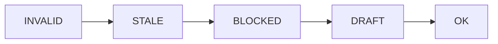

# Manutenção

Este guia é para quem mantém o toolkit de migração. Aqui você aprende a adicionar, atualizar e aposentar agentes e skills, a validar os arquivos, a revisar as versões de referência e a resolver problemas comuns.

O que ainda não existe está na seção [Pendências conhecidas](#pendências-conhecidas), no fim.

## Convenções

- Caminhos são relativos a `.claude/`, salvo quando dizem outra coisa.
- Nomes de agentes, skills, comandos, chaves, ids e estados ficam como estão nos arquivos.
- O idioma segue `CLAUDE.md`, seção "Language":
  - respostas e documentos gerados no projeto: pt-BR;
  - comentários de código: inglês;
  - comentários dentro de um achado de revisão, de um doc ou de qualquer artefato: pt-BR;
  - mensagens de commit: inglês;
  - prompts de agentes e skills, e o próprio `CLAUDE.md`: inglês.

## Adicionar um agente

Um agente é um arquivo `agents/<nome>.md`. Os sete agentes atuais servem de modelo. Os nomes e aliases estão em `CLAUDE.md`, seção "Toolkit".

Os agentes são despachados pelo `/migrate`. Você chama um agente direto só quando o usuário pedir pelo nome ou pelo alias (`CLAUDE.md`, seção "Toolkit").

### Frontmatter

O **frontmatter** é o bloco de metadados no topo do arquivo, entre duas linhas `---`. Ele diz o nome, a descrição e as ferramentas do agente.

As chaves dos agentes atuais são `name`, `description`, `tools`, `skills`, `color` e `effort`. Este é o formato de referência. Ele fica em inglês, como o frontmatter dos agentes atuais (`agents/*.md`):

```yaml
---
name: example-worker
description: "Alias: Example. Does one step of one migration unit and writes one artifact. Dispatched by the migrate skill."
tools: Read, Grep, Glob, Bash, Write, Edit, Skill
skills:
 - migration-conduct
color: pink
effort: xhigh
---
```

- `name` é igual ao nome do arquivo `agents/<nome>.md`.
- `description` começa com `Alias: <Nome>.`, como nos sete agentes. Use aspas duplas. O texto tem `: `, e um valor sem aspas com `: ` quebra o parser YAML (o programa que lê o YAML).
- `color` é uma das cores em uso hoje: `blue`, `cyan`, `green`, `orange`, `purple`, `red` e `yellow`. `pink` está livre.
- `effort` é `xhigh`, como nos sete agentes.
- Nenhum dos sete agentes declara `model`.
- Os agentes atuais não listam `mcp__*`, `AskUserQuestion` nem `Agent` em `tools`. Pergunta ao usuário passa pelo `NEEDS`, e quem despacha é o orquestrador (`skills/migrate/references/routing.md`).

### Ferramentas e skills

- **`tools`**: dê só o que o papel usa.
  - `parity-reviewer` não tem `Edit`, porque não edita código.
  - `behavior-extractor`, `migration-planner` e `parity-reviewer` têm `WebFetch` e `WebSearch`, para consultar a documentação oficial.
  - `spec-writer`, `task-decomposer`, `implementer` e `doc-writer` não têm acesso à web.
- **`skills`**: são carregadas no início do agente.
  - Todos os sete têm `migration-conduct`, com as regras comuns (`skills/migration-conduct/SKILL.md`, seções 0 e 12).
  - Conforme o papel, também:

| Skill | Agentes que a carregam |
|---|---|
| `migration-patterns` | `behavior-extractor`, `migration-planner`, `parity-reviewer` |
| `tdd` | `task-decomposer`, `implementer` |
| `doc-writing` | `doc-writer` |

- Skill de linguagem não entra em `skills`. O agente a carrega pelo nome, com a ferramenta `Skill`, quando lê ou escreve código (`agents/behavior-extractor.md`, "Mode extract", passo 2).

### Corpo e retorno

- Siga a ordem dos agentes atuais:
  1. título com o nome;
  2. um parágrafo com o papel;
  3. `## Inputs`;
  4. o procedimento (`## Procedure`, ou um modo por seção);
  5. `## Rules`;
  6. `## Final message`.
- O toolkit não fixa limite de linhas para o corpo do agente (`convencoes.md`, seção Tamanhos). Mantenha o corpo curto e concreto.
- O retorno segue `skills/migration-conduct/SKILL.md`, seção 12. São no máximo 12 linhas, nesta ordem: `Result:`, `Written:`, `Checks:`, `Skills:`, `Open:` e `NEEDS:`.
- Um `NEEDS` só pode nomear um dono que `skills/migrate/references/routing.md` permite para esse agente. Qualquer outro dono faz a unidade parar (`routing.md`).

### Atualize estes arquivos

1. `skills/migrate/references/routing.md`:
   - na tabela "Owner by state", se o agente for dono de um estado;
   - na tabela "Allowed `NEEDS` owners by worker", uma linha com os donos que o agente pode pedir. Se outro agente pode pedir o novo, acrescente o nome dele na linha desse agente.
2. `CLAUDE.md`, seção "Toolkit": o nome e o alias na lista de agentes.
3. Os documentos de `.claude/docs/` que citam o agente.

`skills/migrate/SKILL.md` não tem lista de agentes. O despacho usa o dono que `routing.md` devolve (`skills/migrate/SKILL.md`, "Stage loop", passo 4).

Depois de editar, confira o frontmatter com um parser YAML e com `claude plugin validate.claude --strict` (veja [Validação oficial de plugin](#validação-oficial-de-plugin)). Rode um caso de teste em um projeto de teste, e não no projeto real.

## Adicionar uma skill de linguagem

Uma skill de linguagem fica em `skills/<linguagem>/SKILL.md`. O nome é em minúsculas e igual ao nome da pasta. A skill `nodejs` é o modelo.

### Estrutura de `skills/nodejs/`

- **`SKILL.md`**: tem o frontmatter com `name`, `description` e `metadata` (`baseline` e `verified`). Depois vem o corpo, com 11 seções e a seção `Sources`:
  1. escopo e versões;
  2. layout e build;
  3. idiomas;
  4. erros, saída e recursos;
  5. concorrência;
  6. dados e números (armadilhas de paridade);
  7. testes;
  8. gate de qualidade;
  9. migrar PARA a linguagem;
  10. migrar DA linguagem;
  11. anti-padrões.
- **`references/`**: arquivos de apoio, em que cada um cuida de um tema.
  - Todas as skills de linguagem têm `as-source.md`, `as-target.md` e `testing-and-tooling.md`.
  - `nodejs` tem mais um arquivo por tema: `runtime-and-esm.md`.
  - O corpo de `nodejs` aponta só para `as-target.md` (`skills/nodejs/SKILL.md`) e `as-source.md`.
  - `runtime-and-esm.md` e `testing-and-tooling.md` não são citados no corpo.
  - Nos `SKILL.md` de `dotnet`, `java` e `python`, `testing-and-tooling.md` também não é citado.

### Passos

1. **Fontes.** Leia a documentação oficial da versão-base antes de escrever um fato. Cada fato de versão ou de runtime cita a URL, e a seção `Sources` reúne as URLs (`skills/nodejs/SKILL.md`, seção `Sources`). Versão de memória não entra na skill (`skills/migration-conduct/SKILL.md`, seção 2).
2. **Metadata.**
   - `metadata.baseline` diz a linha de versão e, entre parênteses, a fonte ou a data de checagem. Exemplo: `"Node.js 22 LTS (v22.23.x docs)"`.
   - `metadata.verified` é a data da leitura, no formato `"AAAA-MM-DD"` (`skills/nodejs/SKILL.md`).
3. **Escopo.** Diga qual versão o código-alvo declara e o que fazer quando ele não declara. O `nodejs` lê `engines.node` do `package.json` ou o `.nvmrc`. Sem declaração, usa `>=22`, e o relatório diz isso (`skills/nodejs/SKILL.md`, seção 1).
4. **Gate.** Liste cada comando, na ordem em que roda, e diga o que ele prova.
   - O gate do `nodejs` (seção 8) tem seis passos.
   - Prettier e ESLint só rodam se o repositório os usa.
   - Rode cada comando e relate a saída real. Um gate que não rodou não é aprovação (seção 8, primeira linha).
4a. **Registro de bibliotecas.** A skill tem uma seção `## Library registry` antes de `## Sources`. Ela dá o link oficial do registro da linguagem (pkg.go.dev, PyPI, npm, Maven Central, NuGet, crates.io ou pub.dev), diz como conferir versão e compatibilidade na página do registro, e aponta para `skills/migration-conduct/references/library-research.md`. O registro também entra em `## Sources`. `tests/check_rules.py` falha se a seção ou o link faltar.
5. **Mecânica de teste.** A skill diz como rodar testes, criar duplos (objetos que imitam dependências) e carregar dados de teste na linguagem. `skills/tdd/SKILL.md` manda o agente buscar essa mecânica na skill de linguagem.
6. **Duas verificações** antes de aceitar a skill:
   - **Formato.** O nome é igual à pasta. O frontmatter tem as chaves de uma skill de linguagem (`name`, `description` e `metadata`). O YAML é válido. Rode `claude plugin validate.claude --strict` e guarde a saída. O toolkit não tem gate próprio para o frontmatter (veja Pendências).
   - **Fatos de versão.** `metadata.baseline` e `metadata.verified` estão preenchidos. Cada fato de versão tem URL na seção `Sources`, e a data de leitura é a de `verified`.
7. **Registre a skill** nas duas listas de nomes:
   - `CLAUDE.md`, seção "Toolkit" (skills de linguagem);
   - `skills/migration-conduct/SKILL.md`, seção 10 (nomes que os agentes carregam).

Esqueleto do frontmatter de uma skill de linguagem:

```yaml
---
name: example-language
description: "Example language 1.0: code, build, tests and quality gate. Use for example-language code, or for migrations to or from it."
metadata:
 baseline: "Example language 1.0 (checked on AAAA-MM-DD)"
 verified: "AAAA-MM-DD"
---
```

Esqueleto de uma skill compartilhada, com `user-invocable: false`. Ela não é chamada pelo usuário, só pelos agentes que a carregam:

```yaml
---
name: example-rules
description: "Shared rules for one role of the migration. Preloaded by the agent that uses them; not invoked by users."
user-invocable: false
---
```

## Atualizar fatos de versão

Use este roteiro quando uma linguagem lança uma nova major (versão com mudança grande) ou um novo LTS (versão de suporte longo).

1. **Ache cada fato da versão antiga.** Busque com `grep -rn "<versão antiga>" skills/<linguagem>`. Confira estes pontos:
   - `metadata.baseline`;
   - a seção 1 (escopo e versões);
   - a versão do runtime nos comandos do gate;
   - a frase de abertura com a data de checagem;
   - a seção `Sources`.
2. **Leia a fonte oficial da nova versão** (página de releases ou de suporte, da seção `Sources`) no dia da mudança. Anote a URL e a data.
3. **Decida o papel da versão antiga.** A nova major vira `baseline`? A antiga vira piso (a menor versão aceita)? A skill `java` faz isso: Amazon Corretto 25 LTS é o baseline, e Java 11 é o piso (`skills/java/SKILL.md`, seção 1). Essa escolha é da equipe. A skill tem que dizer qual foi feita.
4. **Se a página oficial não abrir,** não marque o fato como verificado. Escreva na skill o que falhou e a data. A seção 1 de `skills/java/SKILL.md` faz isso com a página de suporte da Oracle (HTTP 403).
5. **Atualize `metadata.verified`** para a data da leitura. Mude `metadata.baseline` só se a linha de versão mudou.
6. **Confira o frontmatter** com `claude plugin validate.claude --strict`. Veja também que cada fato novo tem URL na seção `Sources`.
7. **Efeito no estado.** O `check.sh` não cita a pasta `skills/`. Ele faz hash só dos artefatos e dos arquivos do alvo (`skills/migrate/scripts/check.sh`, funções `bhash` e `scope_hash`). Por isso, trocar uma skill não muda o estado de nenhuma unidade.
   - Se a versão nova muda o código de uma unidade já construída, `review` e `doc` ficam `STALE` quando o código muda um arquivo listado numa tarefa `done` (`check.sh`, funções `scope_hash`, `review_line` e `doc_line`).
   - O `check.sh` não avisa sobre arquivo que nenhuma tarefa `done` lista.
   - Para refazer a etapa, veja [Solução de problemas](#solução-de-problemas).

### Revisão periódica das baselines

Não há intervalo de revisão definido no toolkit. Para ver quais skills de linguagem têm fatos antigos, leia `metadata.verified` em cada `SKILL.md`. Os valores atuais são de 2026-10-29.

Refaça o roteiro acima quando sair uma nova major ou um novo LTS de uma linguagem coberta.

## Aposentar um agente ou uma skill

Remova o nome de todo lugar em que ele aparece. Hoje são estes:

- `skills/migrate/references/routing.md`: as tabelas "Owner by state" e "Allowed `NEEDS` owners by worker", com a linha do próprio agente e as linhas dos agentes que o pediam.
- `CLAUDE.md`, seção "Toolkit": a lista de agentes com alias, ou a lista de skills de linguagem.
- `skills/migration-conduct/SKILL.md`, seção 10: a lista de nomes de skills de linguagem.
- O campo `skills:` dos agentes que carregam uma skill compartilhada.
- Os documentos de `.claude/docs/` que citam o nome.

Depois, apague `agents/<nome>.md` ou a pasta `skills/<nome>/`.

O `check.sh` não cita nomes de agentes nem a pasta `skills/`. Por isso, aposentar um deles não muda o estado de unidade alguma. Confira com `grep -rn "<nome>".claude` que nada mais aponta para ele.

## Validar o toolkit

### Estados dos artefatos (`check.sh`)

O `skills/migrate/scripts/check.sh` calcula o estado. Ele não guarda estado: lê os artefatos em `docs/migration/` do projeto de migração. Os comandos estão no cabeçalho do script:

| Comando | O que faz |
|---|---|
| `sh check.sh status [unidade]` | Um estado por etapa, e `<unidade> ready YES` ou `NO` |
| `sh check.sh pin` | O HEAD do snapshot tem que ser igual a `source_sha` |
| `sh check.sh cites <arquivo>` | Cada `path:linha @sha7` existe no snapshot |
| `sh check.sh ids [unidade]` | Ids duplicados; cada BR aparece no spec; cada FR aparece nas tarefas |
| `sh check.sh adr [unidade]` | Chaves, seis seções, citações e ids únicos dos ADR; cada DEC da unidade tem ADR |
| `sh check.sh hash <arquivo>` | cksum do corpo, sem frontmatter, em LF |
| `sh check.sh scope <unidade>` | cksum dos arquivos das tarefas `done` |

Um **cksum** é uma soma de verificação: um número que muda quando o conteúdo muda. Um **ADR** é um registro de decisão. Um **DEC** é uma decisão legada que aparece na extração.

Os estados são `MISSING`, `DRAFT`, `BLOCKED`, `INVALID`, `STALE` e `OK` (`skills/migrate/references/stages.md`, tabela "Order and states"). Quando uma etapa tem mais de um motivo, vale esta ordem de precedência (`stages.md`):



Regras de cada etapa no `check.sh` (`skills/migrate/scripts/check.sh`):

- **Artefatos** (extraction, spec, plan, tasks):
  - o `status` do frontmatter dá DRAFT, OK ou BLOCKED. Outro valor dá INVALID;
  - um `upstream_*` com hash diferente dá STALE;
  - chave errada (`unit` ou `stage`) dá INVALID;
  - id duplicado, citação ruim, BR sem FR e FR sem `Source: BR-` também dão INVALID;
  - um PEND com `blocking: yes` e sem resolução dá BLOCKED no spec.
- **extract e plan (DEC e ADR)**:
  - `extract` é INVALID sem a seção de DEC, ou com DEC sem citação;
  - `plan` é INVALID quando `check.sh adr <unidade>` acusa problema, como DEC sem ADR ou ADR com id repetido.
- **build**:
  - INVALID se uma tarefa `done` não tem `evidence:`, ou se um arquivo listado não existe;
  - BLOCKED se há tarefa `blocked`;
  - DRAFT se há tarefa `pending` ou `in_progress`;
  - OK se todas estão `done`.
- **review**:
  - INVALID se `status: ok` tem RV `open` ou `blocked`;
  - STALE se o `scope_hash` não bate com o código atual.
- **doc**: STALE se o cksum de um artefato ou de um ADR na tabela de fontes, ou o `scope_hash`, não bate.
- **READY**: extraction, spec, plan e tasks em OK.

Os campos de cada artefato estão em `skills/migrate/references/templates.md`. Os ids e marcadores estão em `skills/migration-conduct/SKILL.md`, seções 5 e 7.

### Validação oficial de plugin

`claude plugin validate.claude --strict` valida agentes, skills e comandos de um diretório. Com `--strict`, avisos viram erros, e a saída é 1 (`claude plugin validate --help`).

Não há script no toolkit que chame esse comando. Rode-o à mão e guarde a saída.

### Skills com chaves do padrão

`uvx skills-ref validate skills/<nome>` é uma ferramenta externa. Ela não foi executada nesta revisão, e a lista de chaves que ela aceita não foi conferida.

Pelas chaves dos arquivos, ela só se aplica às nove skills de linguagem, que têm apenas `name`, `description` e `metadata`:

- `dotnet`
- `flutter`
- `golang`
- `java`
- `javascript`
- `nodejs`
- `python`
- `rust`
- `typescript`

As outras têm chaves fora desse conjunto:

- `migrate`: `disable-model-invocation` e `argument-hint` (`skills/migrate/SKILL.md`);
- `doc-writing`, `migration-conduct`, `migration-patterns` e `tdd`: `user-invocable: false` em cada `SKILL.md`.

### Checagem independente do hash

Para conferir o `check.sh hash` à mão, calcule o cksum do corpo do arquivo com `awk` e `cksum`. Faça isso sem o frontmatter e em LF (fim de linha só com `\n`).

O valor tem de ser igual ao que `check.sh hash` imprime. Se não for, o hash está errado.

## Solução de problemas

Use a tabela para achar o sintoma. A coluna "O que fazer" diz o próximo passo.

| Sintoma | Causa | O que fazer |
|---|---|---|
| `/migrate` chega ao comando como caminho do Windows | O Git Bash converte o argumento `/migrate` em caminho (observação da equipe; sem arquivo no toolkit) | Inicie o Claude Code com `MSYS_NO_PATHCONV=1`, por exemplo `MSYS_NO_PATHCONV=1 claude` |
| `check.sh` não roda no PowerShell | O script é POSIX `sh`, com LF (`skills/migrate/scripts/check.sh`) | Rode com o `sh` do Git Bash |
| Escrita em `.claude/` pede permissão toda vez | `.claude/` é diretório protegido (observação da equipe) | Aprove a escrita ou ajuste as regras de permissão do Claude Code |
| Uma etapa começa antes de o agente anterior terminar | Agentes em segundo plano | Em execução roteirizada, defina `CLAUDE_CODE_DISABLE_BACKGROUND_TASKS=1` (`skills/migrate/SKILL.md`) |
| Unidade com doc `STALE` depois de mudança de código | O `scope_hash` do doc não bate com os arquivos das tarefas `done` (`check.sh`) | Rode `/migrate <unidade> doc` (`skills/migrate/references/routing.md`). Se a review está `STALE`, rode `/migrate <unidade> review` (`routing.md`). Uma unidade não é dada como pronta com o doc `STALE` (`skills/migrate/SKILL.md`) |
| `plan` fica INVALID com `missing-adr-DEC-NNN` | Há um DEC na extração sem ADR (`check.sh`) | Rode `/migrate <unidade> plan`: o migration-planner escreve o ADR que falta (`skills/migrate/references/routing.md`) |
| `deadline INVALID` no `status` | O campo `deadline` de `MIGRATION.md` não é `none` nem uma data real em `AAAA-MM-DD` | Corrija o campo. Rode `check.sh deadline` (`skills/migrate/scripts/check.sh`) para ver o valor lido |
| `/migrate` não avança: a etapa está congelada | Uma tarefa de `tasks.md` não está `pending` (`skills/migrate/references/stages.md`) | Spec, plan e tasks não rodam de novo. Reporte a mudança ao usuário |
| `cites` mostra `sha-mismatch` | O `@sha7` da citação não é o do `source_sha` (`check.sh`) | Reabra a linha no snapshot e cite com o `sha7` do pin |
| `pin` mostra `INVALID` | O HEAD do snapshot é diferente de `source_sha` (`check.sh`) | Ponha o snapshot no commit do pin. Os agentes param nesse caso (`skills/migration-conduct/SKILL.md`, seção 11) |
| Um `NEEDS` nomeia um dono que a tabela não permite | `routing.md` não lista esse dono para esse agente (`skills/migrate/references/routing.md`) | Se o dono é válido, acrescente-o na tabela "Allowed `NEEDS` owners by worker". Se não é, a unidade para e o caso é reportado |

## Endurecimento opcional com hooks

Um **hook** é um comando que o Claude Code executa sozinho em um evento, como antes ou depois de uma ferramenta rodar.

O toolkit não define hooks. Em `.claude/` só há `settings.local.json`, e ele apenas desativa um plugin (`enabledPlugins`). Hoje as regras dependem do próprio agente e do orquestrador.

Se a equipe quiser reforçar alguma delas, um hook em `settings.json` pode, por exemplo:

- bloquear escrita dentro do snapshot (`skills/migration-conduct/SKILL.md`, seção 6);
- impedir que um agente que não é o dono edite `spec.md`, `plan.md` ou `extraction.md`.

Nada disso existe hoje. O formato do hook segue a documentação do Claude Code, que não foi conferida nesta revisão.

## Pendências conhecidas

- **Empacotamento como plugin não feito.** Não há manifesto de plugin em `.claude/`. O help de `claude plugin validate` cita `plugin.json` na opção `--profile` (`claude plugin validate --help`).
- **Repositório git.** `agents` tem `.git` (branch `master`, sem commit). `.claude/` aparece como não rastreado (`git status`). O `.gitignore` do workspace ignora só `.claude/memory/` (decisão de 2026-10-29). Falta o primeiro commit, que só sai se você pedir.
- **Gate de formato no toolkit.** `tests/gate_format.py` confere o frontmatter de agentes e skills, inclusive YAML estrito. `sh tests/run-tests.sh` roda o gate e os testes do `check.sh`. Ele também confere o orçamento dos agentes: até 100 linhas e 7 KiB cada, e 43 KiB no total (veja `convencoes.md`, seção Tamanhos).
- **Testes do check.sh no toolkit.** Ficam em `tests/`.
  - `test-adr.sh` confere sozinho o subcomando `adr`, o estado do `plan`, o do `extract` e a linha de ADR da `doc`, e define o status de saída.
  - `test-deadline.sh` confere sozinho o subcomando `deadline` e a linha de prazo do `status`, com `CHECK_TODAY` fixo.
  - `test-check.sh` e `test-rules.sh` imprimem o estado de cada cenário (artefato-fonte alterado, citação fora do arquivo, `source_sha` divergente, PEND bloqueante, BR sem FR, tarefa `blocked`, `done` sem evidência, review `ok` com RV aberto, CRLF, artefato removido, uso incorreto). A comparação com o esperado é feita à mão.
- **Validações sem script.** `claude plugin validate` e `uvx skills-ref validate` rodam à mão. Nenhum arquivo do toolkit os chama, e a saída não fica registrada.
- **Intervalo de revisão das baselines não definido.** Veja [Revisão periódica das baselines](#revisão-periódica-das-baselines).
- **Hooks não definidos.** Veja [Endurecimento opcional com hooks](#endurecimento-opcional-com-hooks).
