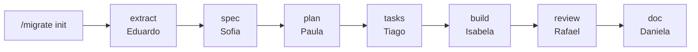

# Toolkit de Migração de Código

Este toolkit ajuda você a migrar um sistema de uma linguagem ou framework para outro, sem perder o comportamento original. O trabalho é dividido em partes pequenas, chamadas **unidades** (por exemplo, um endpoint da API). Cada unidade passa por etapas, e um agente de IA cuida de cada etapa.

Ele roda dentro do [Claude Code](https://claude.com/claude-code). Você copia a pasta `.claude/` para o seu projeto de destino, aponta para o repositório de origem e começa com `/migrate`.

## Sumário

- [Como funciona, em uma imagem](#como-funciona-em-uma-imagem)
- [Antes de começar](#antes-de-começar)
- [Passo a passo](#passo-a-passo)
- [Exemplo de sessão](#exemplo-de-sessão)
- [Comandos](#comandos)
- [Quem faz o quê](#quem-faz-o-quê)
- [Quando algo para](#quando-algo-para)
- [As regras de ouro](#as-regras-de-ouro)
- [Glossário rápido](#glossário-rápido)
- [O que é gerado no projeto](#o-que-é-gerado-no-projeto)
- [Estrutura do toolkit](#estrutura-do-toolkit)
- [Usando em outra migração](#usando-em-outra-migração)
- [Desenvolvimento do toolkit](#desenvolvimento-do-toolkit)
- [Mais documentação](#mais-documentação)
- [Idiomas](#idiomas)

## Como funciona, em uma imagem



Cada etapa faz uma coisa e grava o resultado em um arquivo:

- **extract**: lê o código original e descreve o que ele faz, com citação de linha.
- **spec**: escreve a especificação: o que a nova versão precisa fazer.
- **plan**: decide como cada parte do original vira código na linguagem de destino.
- **tasks**: quebra o plano em tarefas pequenas e ordenadas.
- **build**: escreve o código novo e os testes, testes primeiro.
- **review**: compara o código novo com o original e aponta divergências.
- **doc**: documenta a unidade, em linguagem simples.

O objetivo é a **paridade**: a versão nova aceita as mesmas entradas, recusa as mesmas entradas, devolve as mesmas saídas e os mesmos erros.

## Antes de começar

Você precisa de:

- **Claude Code** com suporte a agentes e skills.
- Um shell `sh`. No Linux e no macOS ele já existe. No Windows, use o **Git Bash**.
- **git**, e acesso de leitura ao repositório de origem (local ou remoto) na tag, branch ou commit que você vai migrar.
- **GitHub CLI (`gh`)** autenticado, só se a origem for um repositório remoto. A skill `gh-check` confere isso para você.

## Passo a passo

1. **Copie** a pasta `.claude/` para a raiz do seu projeto de destino.
2. **Abra** o projeto no Claude Code.
3. **Rode `/migrate init`**. O comando pergunta só o que ainda falta:
   - o repositório de origem (caminho local ou URL);
   - a tag, branch ou commit a migrar;
   - as unidades a migrar.
   Ele cria uma cópia fixa da origem (o *snapshot*), confere o commit exato (o *pin*) e grava a lista de unidades (o *backlog*).
4. **Rode `/migrate status`** para ver o estado de cada etapa de cada unidade. Esse comando só lê, não altera nada.
5. **Rode `/migrate <unidade>`** para avançar a unidade até ela ficar **READY** (pronta para o build). Ele roda as etapas em ordem até terminar ou até parar com uma pergunta.
6. **Quando parar com uma pergunta**, rode `/migrate ask`. Você responde, e o fluxo continua.

### Como informar as unidades

Você pode descrever as unidades de duas formas:

- **Direto**, pelo método e caminho da operação. Exemplo: `POST /v1/users` vira a unidade `post-v1-users`. O agente acha a rota e o handler no código da origem.
- **Por collection**, enviando um export do Postman, OpenAPI ou Apidog. A collection só serve para listar operações e nomes. Os exemplos dela nunca são usados como fonte de comportamento: a fonte é o código no commit fixado. Tokens e senhas viram `<redacted>`.

O id da unidade precisa ter só letras minúsculas, números e hífens (`^[a-z0-9]+(-[a-z0-9]+)*$`).

## Exemplo de sessão

Exemplo ilustrativo, para mostrar a ordem dos comandos. Não é uma saída real.

```
/migrate init          # informa origem, tag e unidades
/migrate status        # confere o que falta em cada unidade
/migrate post-v1-users # roda extract, spec, plan e tasks
/migrate ask           # responde a uma decisão que o código não resolve
/migrate post-v1-users build   # só quando você decidir construir
```

## Comandos

| Comando | Quando usar |
|---|---|
| `/migrate init` | No começo, para preparar o projeto. |
| `/migrate` ou `/migrate status` | Para ver o andamento. Não altera arquivos. |
| `/migrate <unidade>` | Para avançar uma unidade até READY. |
| `/migrate <unidade> <etapa>` | Para rodar uma etapa só. As etapas anteriores precisam estar OK. |
| `/migrate ask [unidade]` | Para responder às decisões pendentes. |
| `/migrate help` | Para ver a ajuda do comando. |

O `build` só roda quando você pedir. Commit, push e PR também: nada disso sai sem o seu pedido.

## Quem faz o quê

| Etapa | Agente (apelido) | O que entrega |
|---|---|---|
| extract | `behavior-extractor` (Eduardo) | Descrição do comportamento e das regras de negócio, com citação de linha. |
| spec | `spec-writer` (Sofia) | Especificação: requisitos, o que fica de fora e as dúvidas em aberto. |
| plan | `migration-planner` (Paula) | Mapa de cada parte da origem para a linguagem de destino. |
| tasks | `task-decomposer` (Tiago) | Lista ordenada de tarefas pequenas. |
| build | `implementer` (Isabela) | Código novo e testes. |
| review | `parity-reviewer` (Rafael) | Lista de divergências em relação ao original, com rodadas de correção. |
| doc | `doc-writer` (Daniela) | Documentação da unidade, em pt-BR e linguagem simples. |

Você também pode chamar um agente direto, pelo nome ou apelido, mas o caminho normal é sempre `/migrate`.

## Quando algo para

Cada etapa recebe um dos estados abaixo. O `/migrate status` mostra qual é o de cada uma.

| Estado | O que significa | O que fazer |
|---|---|---|
| `MISSING` | O arquivo da etapa ainda não existe. | Rode `/migrate <unidade>`. |
| `DRAFT` | Foi escrito, mas não terminou. | Rode a etapa de novo ou responda às pendências. |
| `BLOCKED` | Falta uma decisão bloqueante. | Rode `/migrate ask`. |
| `INVALID` | Não passou numa verificação de formato ou de citação. | Rode a etapa de novo. |
| `STALE` | O código ou uma etapa anterior mudou depois. | Rode a etapa de novo. |
| `OK` | Válido e atualizado. | Nada. |

Uma unidade fica **READY** quando extract, spec, plan e tasks estão OK.

Quando um agente não consegue decidir sozinho, ele não chuta. Ele para e escreve uma pergunta, que aparece em `/migrate ask`. Antes de perguntar, ele investiga o código original e as bibliotecas. Só pergunta o que o código não responde.

**Depois de um `/clear`**, rode `/migrate` de novo. O progresso fica nos arquivos, não na memória da conversa.

## As regras de ouro

1. **Sem chute.** Toda afirmação sobre o original vem com a linha de código que a comprova.
2. **Sem regra inventada.** A regra de negócio é o que o código faz de verdade.
3. **Bug vira bug documentado.** Um erro do original é mantido e marcado como `known-issue`. Não é corrigido em silêncio.
4. **O código é a fonte da verdade.** Specs e docs antigos servem só de contexto.
5. **Docs em dia.** Se o código mudar, o documento antigo vira `STALE` e é gerado de novo.
6. **Investigar antes de perguntar.** Primeiro o código, depois as dependências, depois a documentação oficial.
7. **Preservar decisões legadas.** Se o original faz algo que contraria a boa prática, isso fica mantido e registrado em um ADR (um registro curto, com o motivo).

As regras completas estão em `.claude/skills/migration-conduct/SKILL.md`.

## Glossário rápido

| Termo | Significado |
|---|---|
| **Unidade** | Menor parte do código que funciona sozinha. Ex.: um endpoint. |
| **Snapshot** | Cópia fixa da origem, feita fora do projeto de destino. Nunca é alterada. |
| **Pin** | O commit exato da origem usado como referência (`source_sha`). |
| **Artefato** | Arquivo que uma etapa grava, em `docs/migration/<unidade>/`. |
| **Backlog** | A lista de unidades a migrar, em `docs/migration/MIGRATION.md`. |
| **ADR** | Registro de uma decisão legada mantida de propósito, com o motivo. |
| **`known-issue`** | Marcador de um bug do original que o destino mantém de propósito. |

Glossário completo em [.claude/docs/README.md](.claude/docs/README.md).

## O que é gerado no projeto

```
docs/migration/
├── MIGRATION.md        # origem, commit fixado, destino, idiomas, limites e backlog
├── adr/
│   └── ADR-NNN-<slug>.md
└── <unidade>/
    ├── extraction.md   # extract
    ├── spec.md         # spec
    ├── plan.md         # plan
    ├── tasks.md        # tasks
    └── review.md       # review
```

Todo arquivo começa com `status: draft`. Os formatos estão em `.claude/skills/migrate/references/templates.md`.

## Estrutura do toolkit

```
.
├── .claude/
│   ├── CLAUDE.md           # instruções do toolkit (têm prioridade)
│   ├── settings.local.json # mostra o status ao abrir a sessão
│   ├── agents/             # os sete agentes, um por etapa
│   ├── skills/             # o orquestrador (migrate), as regras e as linguagens
│   ├── docs/               # documentação humana, em pt-BR
│   ├── tests/              # testes do toolkit
│   └── memory/             # memória local do Claude (fora do git)
└── README.md
```

## Usando em outra migração

O toolkit não é preso a um projeto. Para reutilizá-lo:

1. Copie `.claude/` para o novo projeto de destino.
2. Rode `/migrate init` com a nova origem e o novo destino.
3. Se o seu par de linguagens não existir, crie uma skill em `.claude/skills/<linguagem>/`, seguindo uma já existente. O guia está em `.claude/docs/manutencao.md`.

Só `docs/migration/` e o snapshot são específicos de cada projeto, e são gerados na execução.

## Desenvolvimento do toolkit

Para testar o toolkit, rode a suíte completa a partir da raiz do repositório:

```sh
sh .claude/tests/run-tests.sh
```

A última linha mostra `run-tests exit=<código>`. Código `0` quer dizer que tudo passou. Python é necessário só para essa suíte.

Comandos úteis:

```sh
sh .claude/skills/migrate/scripts/check.sh status        # estado de cada unidade
sh .claude/skills/migrate/scripts/check.sh pin           # confere o commit do snapshot
sh .claude/skills/migrate/scripts/check.sh cites <file>  # confere as citações
sh .claude/skills/migrate/scripts/check.sh ids [unit]    # procura ids duplicados
```

Ao mudar um agente, uma skill ou o `check.sh`, atualize o doc correspondente em `.claude/docs/` e rode a suíte de novo.

## Mais documentação

A documentação humana, em pt-BR, está em `.claude/docs/`:

- [README.md](.claude/docs/README.md): visão geral, início rápido e glossário.
- [arquitetura.md](.claude/docs/arquitetura.md): como agentes e skills se encaixam.
- [agentes.md](.claude/docs/agentes.md): os sete agentes em detalhe.
- [skills.md](.claude/docs/skills.md): skills de fluxo, de conduta e de linguagem.
- [fluxo.md](.claude/docs/fluxo.md): etapas, artefatos, estados e receitas.
- [convencoes.md](.claude/docs/convencoes.md): nomes, marcadores e ids.
- [manutencao.md](.claude/docs/manutencao.md): como manter o toolkit.

## Idiomas

- Respostas ao usuário e docs gerados da migração: pt-BR.
- Código, comentários, mensagens de commit e prompts de agentes: inglês.
- Identificadores, caminhos, comandos, SQL e mensagens de erro nunca são traduzidos.
